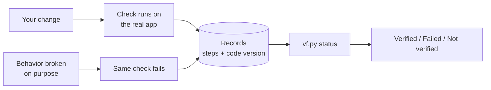

# verification-framework

Your coding agent says "done, tests pass." Does the feature work?

You can't tell from the report. Unit tests replace the database, the browser, and other services with fakes, so they pass while the real app fails. A test that could never fail passes too. And nothing says which version of the code was tested.

An engineer handed a device to test doesn't take its word for it. They build a **test bench**: instruments that drive the device and read it from outside, each calibrated against a known fault before its readings count, and a notebook that records every measurement and the exact unit it was taken from.

These skills have an agent build that bench around your running app, with you deciding what gets measured:

- **The instruments** are command-line tools in your project's language: probes that read the app's data, actions that do what a user or operator does, a doctor that reports what's running, and checks that drive one behavior and read back the result from the database, the response, or the screen, never from the app's own code.
- **Calibration** is a planned break: the behavior broken on purpose in a throwaway copy of the app, and the check shown to fail there. Until that happens, the check's passes don't count.
- **The notebook** is a record of every run, with the commit tested in every repo and, when the run drove a screen, a video: a failed run keeps it, and a passing one can be cut into a short clip for your pull request. A script, not the agent, turns those records into a verdict for each behavior: **Verified**, **Failed**, or **Not verified** with the reason.

You agree on what each check will prove before the agent builds it, from your requirements rather than the code, and a separate agent reviews the check against that agreement. The instruments stay in your repo for debugging by hand, and the agent uses the bench to verify its own change before it says "done."

The skills follow the [Agent Skills](https://agentskills.io) format and work with Claude Code, Codex, Cursor, and any other agent the `skills` CLI supports.

## How it works

The bench lives in your app's repo as a **verification harness**: one folder that holds how to start the app, which behaviors to check, the instruments, and the record of every run. Every harness has the same layout, so anyone who knows one can read another.



A planned break never touches your working folder. An agent can lower a verdict with a reason but can't raise one.

[USAGE.md](USAGE.md) walks through setting up a harness, adding checks, and verifying a change. [docs/internals.md](docs/internals.md) describes the files and scripts underneath.

### Compared with end-to-end tests

Automated tests report whether they passed; this framework addresses whether that pass should be believed when a coding agent wrote the code, the test, and the report. A check counts only after it has failed on a broken copy of the app, judges from outside the app's code, and gets its verdict from a script the agent can lower but not raise. The procedure is written as skills; the script is what's enforced mechanically.

## Install

A repo that already has a harness needs no install. The three skills are committed beside it, in the same skills directory, so your agent finds them in a fresh clone. Ask it to verify a change, or type `/vf` and ask what the harness can do.

Install the framework to set up a harness, or to update one you own. With the [`skills` CLI](https://skills.sh) (needs Node.js):

```sh
npx skills add kennymatsudo/verification-framework          # pick skills and agents interactively
npx skills add kennymatsudo/verification-framework --list   # list skills without installing
```

As a Claude Code plugin (no Node.js needed):

```text
/plugin marketplace add kennymatsudo/verification-framework
/plugin install verification-framework@verification-framework
```

The plugin prefixes each skill with `verification-framework:`, so the starting skill is `/verification-framework:vf`. In a repo with a harness, `/vf` runs the repo's committed copy and `/verification-framework:vf` the installed one, which is the one that updates it.

Install all three skills. Setup commits a copy of each beside the harness and stops when one is missing.

To check the install, run `/vf` and ask "what can this framework do?".

To update, run `npx skills update`, or `claude plugin marketplace update verification-framework` followed by `claude plugin update verification-framework@verification-framework`. Then run vf in each repo with a harness and ask it to update the harness: it replaces the harness's copies of the rules, the scripts, and the three skills in one change, which you commit for your teammates. Every skill passes the Rules version it was written for to the harness's `vf.py validate`, so a personal install on another version than the repo's copies fails with the side to update.

The committed copies are vendored files. Mark them `linguist-vendored` in `.gitattributes` and exclude them from your linters, so language statistics and lint runs skip them; with the skills under `.agents/skills/`:

```gitattributes
.agents/skills/vf/** linguist-vendored
.agents/skills/vf-verify/** linguist-vendored
.agents/skills/vf-explain/** linguist-vendored
```

## Try it

In your app's repo:

```text
/vf Set up verification for this app.
```

vf reads how your app starts, asks only what it couldn't find, and proves the app can be started and inspected. It leaves a small `verify-<app>` skill in the repo, such as `verify-storefront`.

Then build checks and tools, and verify a change:

```text
/vf-verify Add checks for paying with a saved card.
/vf-verify Add a way to look up an order.
Use verify-storefront to verify my saved-card change.
```

Each one previews what it will build and asks before touching anything shared.

## Skills

Start with vf if you're not sure which you need.

| Skill | What it does | Who starts it |
| --- | --- | --- |
| [vf](skills/vf/SKILL.md) | Sets up or updates a harness, audits it for gaps and weak checks, and tests a teammate's pull request | You, by name |
| [vf-verify](skills/vf-verify/SKILL.md) | Verifies a change, and builds the checks and tools the harness lacks, each proven on the real app | You or your agent |
| [vf-explain](skills/vf-explain/SKILL.md) | Tells a teammate what the harness checks and how far to trust each pass. Writes nothing in the repo | You or your agent |

[Choose a skill](USAGE.md#choose-a-skill) has an example request for each job.

## Requirements

| Need | Required | Used for |
| --- | --- | --- |
| Git | Yes | Code versions in records, throwaway copies for planned breaks |
| Python 3 | Yes | The framework scripts (standard library only) |
| ffmpeg | Optional | Still frames for agents and video clips for pull requests |

Without ffmpeg, agents diagnose failures from the saved screenshot and logs instead. Install it with `brew install ffmpeg` on macOS, your package manager on Linux, or `winget install Gyan.FFmpeg` on Windows. In a harness, `scripts/framework/vf.py clip --check` says what this machine can make. Agents never install it on their own.

Whatever the app itself needs, such as a database or a login, is recorded in its harness during setup.

## License

MIT. See [LICENSE](LICENSE).
