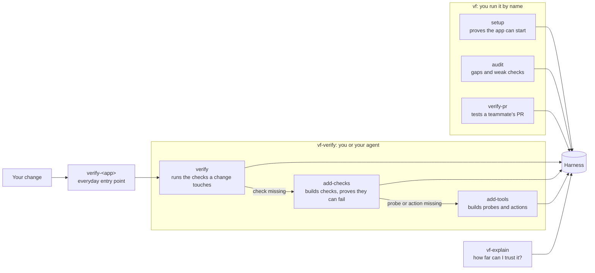

# Use the verification framework

The verification framework is a set of agent skills that build a test bench around your real, running app: command-line tools that drive and read the app from outside, checks that must fail on a planned break before their passes count, and a record of every run. An agent builds the bench with you in the loop and uses it to verify a change, reporting which behaviors it couldn't test and why.

The bench lives in your app's repository as a **verification harness**: one folder that holds how to start the app, which behaviors to check, the instruments, and the record of every run. The [README](README.md) covers installing the skills. [Harness internals](docs/internals.md) covers the files and scripts underneath.

## What Verified means

Every behavior the framework tests is reported as **Verified**, **Failed**, or **Not verified**. Verified is a strong claim. It answers the four questions an engineer asks before trusting a reading from a bench:

| Question | What the record must show |
| --- | --- |
| Was it the real device? | The check ran on the real app, not a copy with its database or other services faked |
| Which unit? | The exact code version tested, in every repository the app runs from. A pass on `main` says nothing about your branch |
| Was the instrument calibrated? | The check has failed when the behavior was broken on purpose. A check that passes on broken code can't tell working from broken |
| Is the measurement in the notebook? | The run left a record anyone can open or rerun |

The calibration is called a **planned break**: the behavior broken on purpose in a throwaway copy of the code, never in your working folder, and the check shown to fail there. The record of that failing run is kept, and a pass counts only while the check is still the one that was calibrated. Edit the check and the pass drops to Not verified until the break is run again.

The harness's `vf.py status` computes every verdict from the records; agents and people don't write them. [How a behavior earns Verified](docs/internals.md#how-a-behavior-earns-verified) follows one example step by step.

A new bench has one instrument, the doctor, and checks nothing yet. Setup only proves the app can be started and read. Checks are added afterward, one behavior at a time, and anything without a check is Not verified.

## Your first session

This walkthrough sets up a harness for a store app called storefront, adds a check for paying with a saved card, then verifies a change. The agent messages are examples. Every message that needs an answer ends with a `Needs you:` line holding one question, with a recommended answer when your requirements or project settle it and the options when nothing does.

### 1. Set up the harness

In the app's repository, ask:

```text
/vf Set up verification for this app.
```

The agent reads your startup scripts and docs to learn how the app starts, and asks only what it couldn't find, one question at a time. Starting the app on your machine needs no approval. When a step needs you or touches something shared, it tells you first:

```text
I found how to start your app: `docker compose up` in dev/. I'll start it myself, then build and test a readiness check against it.
I won't run `make seed`, which writes to the shared staging database.

Needs you: starting it opens a cloud login only you can complete. Will you sign in when it prompts? I recommend yes; it signs in only this machine. Then I'll start it and build the check.
```

It creates a folder such as `.agents/skills/verify-storefront/` and builds the bench's first instrument, the **doctor**: a command that reports whether the app is running and which code it's running, without changing anything. To prove the doctor works, it runs it with the app up (must say ready) and with the app stopped (must say not ready). If you started the app yourself, it skips the second run and says so.

Setup ends with a short message that the harness is ready and two suggested next steps.

### 2. Add checks for a feature

Ask:

```text
/vf-verify Add checks for paying with a saved card.
```

Before building anything, the agent previews what it will prove:

```text
Build saved-card payment on main (storefront 4f2a9c1)

Will prove: a returning shopper can pay with a saved card
How: submits checkout through the real checkout API with a saved card; reads back the order and payment records from the database
Won't prove: what the confirmation screen shows
Sources: launch checklist, row 4

Needs you: should a saved card that has expired be rejected before checkout? No requirement settles it. Reject: the shopper sees an error before paying. Accept: the charge is tried and may fail. Then I'll build the check with your answer.
```

Each behavior is named the way a user would describe it. Its short ID, such as `checkout.saved-card`, stays in the harness files. The agent asks about expected behavior only when your requirements leave it open, and a question nothing settles comes with the options and no recommendation. It doesn't take expected behavior from the code, because the code may be what's wrong.

The agent writes the check. A second agent, which never sees the first one's reasoning, compares the check with the agreed preview, and looks again at any later change to it. Then the agent calibrates it by proving it can fail:

```text
Planned break: skip saving the payment record in billing/charge.py.
```

It makes that change in a throwaway copy of the repository, runs the check there, confirms it fails, and deletes the copy. The final report says how many behaviors are now Verified and what was broken to calibrate each check.

### 3. Verify a change

After changing the saved-card code on a branch, ask:

```text
Use verify-storefront to verify my saved-card change.
```

`verify-storefront` is the skill setup created for this app. The agent works out which behaviors the change could affect, shows a preview, confirms the running app is on your branch's code, runs each check, and reports:

```text
Saved-card change verified on add-saved-cards (storefront 9e1d0b7): 1 Verified, 1 Not verified

- A returning shopper can pay with a saved card: Verified.
- An expired saved card is rejected: Not verified. No check yet.
Details: .agents/skills/verify-storefront/status.md
```

Within the scope you agreed to, the agent can build a missing check in the same run, unless you asked for existing checks only.

A check that drives a screen records its run. A failed run keeps the video, and the report links its replay page. When this computer can make clips, a verify run keeps the video of a screen check that passed too, and the agent offers to cut a short clip of the changed behavior for your pull request. Otherwise, keep a passing run's video by running the check with `VERIFY_KEEP_RECORDING=1`. Every kept recording is listed on the harness's `recordings.html`, and the report's `Details:` line names it.

## Choose a skill

Not sure? Type `/vf` followed by what you want, in your own words. It looks at what the repo has, picks a plan, and runs the matching skills in order. When it must first do something you didn't ask for, such as setting up before it can verify, it shows the steps and waits for your yes.

| What you want | Skill | Example request |
| --- | --- | --- |
| Not sure which you need | vf | "Did my change work?", "what can this do?" |
| Create a harness, resume a stopped setup, or update one after updating the framework | vf, setup mode | "Set up verification for this repo", "update the harness" |
| Add checks for a behavior | vf-verify, add-checks mode | "Add checks for checkout", "what should we add next?" |
| Add a probe (reads the app's data) or an action (does what a user would) on its own | vf-verify, add-tools mode | "Add this script as a tool", "add a way to look up an order" |
| Verify a change or a feature | verify-\<app\>, made by setup | "Use verify-storefront to verify my change" |
| Find what the harness doesn't check | vf, audit mode (coverage) | "Audit coverage", "what aren't we checking?" |
| Find checks that would still pass if the behavior broke | vf, audit mode (weak checks) | "Audit weak checks", "are our tests fake?" |
| Understand how far to trust a pass | vf-explain | "Can I trust these checks?", "how is checkout checked?" |
| Test a teammate's pull request on the real app | vf, verify-pr mode | "Verify PR #123" |



vf runs only when you call it, so setup, audit, and PR verification never start on their own. Your agent may start vf-verify to verify its own change, and vf-explain because it only reads. After setup, use the app's own verify skill for everyday work.

## Set up a harness

vf's setup mode builds the bench's frame: it creates a harness, or resumes one whose setup stopped, and proves the app can be started and read.

1. It works out which app to cover from your request and the project. If the app's code lives in other repositories, it follows the references to them. When two could match, it asks which.
2. It creates the harness folder right away with setup marked unfinished, so a later session can pick up where this one stopped.
3. A separate agent reads the startup scripts, required tools, and where requirements are written. It changes nothing. You're asked only what the project couldn't answer.
4. When a step needs a person or has an effect outside your machine, it shows a setup note (how it will start the app, what needs you, what it won't run) and waits for your yes.
5. It fills in the harness's settings and creates the app's verify skill, an empty feature list, the doctor, and a guide to the harness's commands. It doesn't edit your Git ignore files.
6. It starts the app, or asks you to when only a person can, and proves the doctor works. Setup is marked ready only after the doctor's output is saved and `vf.py validate` passes.

At the end, it asks permission to add one line to your project's agent instructions pointing to the harness's command guide. If you decline, the guide still exists, but other agents won't find it on their own.

### One harness or several

Start with one harness. It can cover many features and code spread across several repositories. Use separate harnesses for apps that run separately, with different startup or access needs:

```text
commerce/
├── apps/
│   ├── storefront/
│   └── admin/
├── services/orders/
└── .agents/skills/
    ├── verify-storefront/   shopping, checkout, order confirmation
    └── verify-admin/        staff order search, refunds, permissions
```

A change to the shared orders service may need checks from both, so name both apps when you ask. A pass in storefront doesn't show that admin works.

When the app is one folder of a larger repository, setup puts the harness in that folder's skills directory. Its commands then run from the app's folder, and edits elsewhere in the repository don't count as changes to its code.

### Resume a stopped setup

Setup stops and saves what it learned, rather than guessing, when it can't find how to start the app, finds several ways, needs a repository or a login only you have, or finds no way to run the app locally. It says what it needs. It never asks for or saves passwords.

Run vf again to resume. It rereads its notes, checks they're still true, and continues. It doesn't reuse approvals from an earlier session. While setup is unfinished, every other skill stops at the start and says what would resume it.

### Update a harness after updating the framework

Each harness keeps its own copy of the shared rules and the framework scripts, and the skills directory holding it keeps a copy of vf, vf-verify, and vf-explain, so teammates who clone the repo have everything without installing the framework. After every framework update, run the installed vf in the repo and ask it to update the harness. It replaces each copy that differs, names the files it replaced, and runs `vf.py validate`; commit the result for your teammates. The repo's own copy of vf can't do this, and says so with the install command.

If a copy was edited since the last update, it shows the edit and asks before replacing it. A fix you need in a framework script belongs in the framework, not the harness. If the harness's rules are newer than the installed skills, it asks you to update the skills instead. A skill on another Rules version than the harness fails `vf.py validate` and names the side to update.

### Harness files

Everything on the bench lives in one folder:

| File | What it holds |
| --- | --- |
| `README.md` | Where a person starts |
| `recordings.html` | Each check's latest run, its history, and any videos |
| `settings.md` | This app's repositories and the commands that start, stop, check, and inspect it |
| `status.md` | The latest result for each behavior, written by the framework |
| `notes.md` | Setup notes, known failures, where a pass can mislead, untested cases |
| `features/` | One file per feature, listing its behaviors and how each is proven |
| `tools.md` | A guide to every instrument |
| `scripts/` | The instruments: the doctor, the checks, the probes, and the actions |
| `scripts/framework/` | The framework scripts, copied unchanged |
| `evidence/` | One folder per check holding the record of each run |
| `rules.md` | The shared rules every harness follows, copied unchanged |
| `SKILL.md` | The app's verify skill, which points vf-verify at this harness |

Don't edit `rules.md` or anything in `scripts/framework/`. They're identical in every harness, so an update can replace them in one step. Your team decides whether to keep records in Git. [Harness layout](docs/internals.md#harness-layout) shows every file.

## Add checks for a feature

vf-verify's add-checks mode builds the checks that test a behavior and calibrates each one. Name what you want, such as "add checks for checkout". The agent previews first: the behaviors in plain words, how it will use the app, what it will read back, what it won't prove, and the requirements that set the expected behavior. The agreed plan is saved in the feature's file.

Ask "what should we add next?" for three to five suggestions, with one recommended. It builds nothing until you pick.

### The instruments

Four kinds of instrument go on the bench:

| Instrument | What it does |
| --- | --- |
| Check | Uses the app the way a user would, then reads back every result to judge it. Not trusted until it has been calibrated by a planned break |
| Probe | Answers a question about the app's current data, such as `probe order o_123`. Changes nothing |
| Action | Does something a user or operator would do, through the same button or address they use. Refuses to touch anything shared without `--user-approved` |
| Scenario | A check that walks a whole user journey across several features |

Every instrument reads the device, not its self-report: results come straight from the database, the raw web response, or the screen, never through the app's own code. If a tool asked the app whether an order was paid, a bug in that code could make a broken feature look fine.

### Where a check starts

A check can start in the browser or at the app's web API, the addresses the page calls. A browser check proves a user completes the task and sees the right result. An API check proves the server behaves, but not what the user sees. The preview always says where a check starts and what it can't show. Nothing picks between these for you, so name the one you want.

### Calibration: planned breaks

A check is calibrated by a planned break. Before each one, the agent tells you `Planned break: <the change>`. A framework script copies your code, uncommitted edits included, into a throwaway copy, points the app at it, saves the change beside the run's record, and puts everything back afterward. While that copy is in use, ordinary verification waits.

A break calibrates only the behavior it was aimed at, and only when a step checking that behavior failed. Breaking payment can make a later receipt step fail too, but that proves nothing about the receipt. [Prove a check with a planned break](docs/internals.md#prove-a-check-with-a-planned-break) has the mechanics.

### What the report says

It opens with how many behaviors are now Verified, then one line per behavior: what was broken to calibrate its check, or why it isn't proven yet. It names any expectation the agent changed after you agreed to the plan, and any test data left somewhere shared.

A check for behavior your team wants but hasn't built yet stays in the harness and keeps failing, with the ticket that tracks the work.

## Add a tool on its own

vf-verify's add-tools mode adds an instrument, a probe or an action, before any check needs it. Give it a script, a request you found (such as an undocumented API call), or a way to find one (such as watching the browser's network requests). It keeps the request, rewrites the rest to the harness's rules, and proves it on the real app. A separate agent reviews each tool before it runs.

A tool reads passwords and tokens from your project's settings, never from a captured request. When the project has no setting for one, set it yourself as an environment variable. The tool guide names the variable, and `vf.py validate` rejects a tool with a secret written into it.

An action normally touches only records the harness created. To act on a real record, name it. The agent passes its ID with `--user-approved` for that run only.

## Verify a change

Use the app's verify skill, such as `verify-storefront`, to verify a change or a whole feature:

- "Use verify-storefront to verify my saved-card change."
- "Use verify-storefront to verify every checkout behavior."

With no change named, it lists what the harness can check, marks the behaviors your current changes touch, and waits for you to pick.

1. It runs `vf.py validate` and stops if the rules copy was edited or setup is unfinished.
2. It traces your change through the code to find every behavior it could affect, and shows the preview.
3. For a behavior with no check, it builds one within the scope you agreed to. If you asked for existing checks only, the gap is reported instead.
4. It runs each check through `vf.py verify`, which runs the doctor first and tests only an app that's ready and running your requested version. If the app is running other code, it stops and says so rather than restarting an app it didn't start.
5. It confirms each check tests the agreed behavior. It never swaps in a different route to the same result, and never treats a failing check as a missing one.
6. If your change alters a behavior, it updates that feature's file.
7. It records each result with the version tested and stops only the processes it started.

The report puts what went wrong before what passed. A Failed behavior that was recorded on video links its replay page. After a passing check that drove a screen, the agent offers to cut a short clip for your pull request.

## Ask how far to trust a pass

vf-explain is for someone who didn't build the bench and didn't watch it run. It reads the harness and runs nothing. For every check it answers the five questions an engineer asks of an instrument:

1. Does it do what a user does?
2. Does it look at the result itself, rather than asking the app?
3. Was it calibrated? Has it been seen to catch a problem?
4. Was it the unit you care about? Did it run on that code?
5. Is the measurement in the notebook? Can you see the proof?

Ask with no question and it walks one real check through those five, says where trust is weakest, and suggests what to ask next. Name a feature or a pass and it answers for just those. Ask for a page to share and it writes one HTML page outside the repo.

## Keep the bench matching the app

A bench drifts from the app over time: features change, checks get edited, and an instrument that was calibrated once may not be any more. vf's audit mode looks for this in two ways.

### Find what has no check

"Does this harness cover the app as it is today?" One agent per feature reads the app's code to find where the feature files no longer match it. Then every check runs on the real app, and any check whose code changed is recalibrated with its planned break. A wrong feature file gets fixed. A tool that can't test working behavior gets fixed and rerun. A bug in the app is reported with its record. The audit ends as clean, changed, or blocked.

### Find checks that cannot fail

"Would each check go red if the behavior it guards broke?" It never runs the app. It works on the harness's own code: in a throwaway copy, it makes each of the harness's rule-checking functions always answer "nothing is wrong" and sees whether any of the harness's unit tests notices. It also looks for tests that check nothing, tests switched off, and checks weakened since the last audit. One set of agents finds problems and a separate set confirms each one.

It fixes clear-cut problems in your working copy, with a test shown failing before and passing after, and leaves them uncommitted. It offers to commit them under a title starting with `Audit harness checks`, so the next audit knows where to start.

### Test a teammate's pull request

vf's verify-pr mode tests a pull request on the real app, or several across repos that make one change. It lists every fix and test case the PR claims, anything its ticket asks for that the description misses, and any change a user could notice that neither mentions. It sorts each one:

- **Add**: the result depends on two or more parts of the system agreeing, and no check covers it.
- **Already covered**: an existing check proves it and will be rerun on the PR's code.
- **Add with a missing step**: it belongs in the harness, but no check reaches that situation yet.
- **Skip**: one part of the system decides the result alone, so its unit tests are the right place.

You approve the list.

It checks out each PR in a git worktree of its own, so your checkouts stay as they are, builds the approved checks on a branch named `vf-verify-pr/<number>-checks`, and runs them with every PR's code loaded together. It drafts a comment and posts it only when you say so. When a check showed the changed behavior on screen, the draft comes with a short demo video, reviewed for anything that shouldn't be public.

At the end it offers to open a pull request for the new checks, so they merge with the code they test.

## Read results

The bench's notebook is three things: `status.md` holds each behavior's verdict, `evidence/` holds every run, and `recordings.html` shows the runs that were recorded.

### Messages

Every skill writes its messages the same way. A message that needs your answer ends with the `Needs you:` line from the walkthrough, and nothing comes after it, so the last line always tells you whether the agent is waiting on you. The line recommends an answer only when your requirements, the project, or a permission you granted settle it; otherwise it gives the options and leaves the choice to you.

A preview has the same lines in the same order: Will prove, How, Won't prove, Gaps, Sources. A line with nothing to say is left out. A report opens with the outcome, puts what went wrong first, and fits in 12 lines. A `Details:` line names where the full record is, and a report with nothing to ask ends on the outcome. Versions, commands, and record paths stay in the harness's `status.md` and `notes.md`.

### Verdicts

| Verdict | Means |
| --- | --- |
| **Verified** | The latest run passed on the named version, with the app confirmed ready. The same check was calibrated by a planned break aimed at this behavior, its code is unchanged since, and nobody has recorded a reason not to trust it |
| **Failed** | The latest run failed. The result names the step and what it found, with a replay page when recorded |
| **Not verified** | Not proven. The result gives the reason: no check, no run yet, a run that stopped, a check never shown to fail, a pass whose break no longer backs it, or a blocker the agent recorded |

An agent can lower a result with `vf.py not-verified` but never raise one. What people write beside the results, such as where a pass can mislead, lives in `notes.md`. Read both.

Three limits to keep in mind:

- A pass counts only for the version it ran on.
- A check that reads only stored data doesn't prove what the user saw on screen.
- A run that stopped early has no verdict and is reported as Not verified.

### Recorded runs

A check that uses a screen records a video and keeps it when the run fails, or when you ask by setting `VERIFY_KEEP_RECORDING=1`.

Open `recordings.html` in the harness to see how the checks are doing. Each check gets one line for its latest run, failing checks first: the result (Failed, Passed, or Didn't finish), the first failed step or the reason it stopped, and when it ran. A Watch button opens the video a few seconds before the failure. Details show every failed step, each repo's branch and commit, earlier runs, and the replay page. Filter or search at the top.

Two commands work on a single run:

```sh
scripts/framework/vf.py replay <record>                  # replay page: video beside the steps, j/k jump between failures
scripts/framework/vf.py clip <record> --steps 2-3        # short MP4 of those steps, for a pull request
scripts/framework/vf.py clip <record> --steps 2-3 --demo # same, with waits cut short and the result held on screen
```

Clips need ffmpeg. `vf.py clip --check` says whether this computer can make them (see the README's [Requirements](README.md#requirements)).

Agents don't watch the video. A failed step saves a screenshot and the page's text, and the run saves the browser's errors and failed requests. An agent works out the failure from those, then from a few still images (`vf.py clip <record> --frames failed`).

## Use the instruments by hand

The bench's instruments are ordinary command-line programs in your project's language, in the harness's `scripts/` folder. Use them while debugging, without starting a skill. A probe answers "what state is order o_123 in?" without hand-writing a database query.

`tools.md` describes each command: when to use it, how to run it, what it may change, and what it can't show. Every command answers `--help` without connecting to anything.

A probe's answer describes the app's current data. It isn't a Verified result on its own.

## Glossary

- **Skill**: a set of written instructions an AI agent loads to do one kind of job.
- **Mode**: one job inside a skill. vf's modes are setup, audit, and verify-pr; vf-verify's are verify, add-checks, and add-tools.
- **Verification harness**: the app's test bench, a `verify-<app>/` folder in your repository holding the app's settings, feature list, checks, results, tools, and records.
- **App verify skill**: the skill setup creates for one app, such as `verify-storefront`. The everyday way to verify a change; it points vf-verify at the harness.
- **Repository**: one Git project folder. An app may run code from several.
- **Commit**: one saved snapshot of the code in Git, named by a short code such as `a1b2c3d`.
- **Settings**: the harness's `settings.md`, with everything specific to one app: repositories, where requirements live, and the commands that start, stop, check, and inspect it.
- **Feature map**: the files in `features/` listing each feature, the behaviors in it, and how each is proven.
- **Sub-feature**: one behavior a user would notice, such as paying with a saved card, with a short ID such as `checkout.saved-card`.
- **Instrument**: any tool on the bench: a check, probe, action, or the doctor.
- **Check**: a program that uses the app the way a user would, then reads back what happened to judge the result.
- **Evidence file**: the saved record of one check run, with each step's result and the code version tested.
- **Planned break**: the smallest deliberate change that makes a behavior wrong, made in a throwaway copy of the code to show its check fails. The bench's calibration step.
- **Doctor**: a command that reports whether the app is running and ready to test, and which code it's running, without changing anything.
- **Probe**: a command that answers a question about the app's current data without changing anything.
- **Action**: a command that does something a user or operator would do, through the same entry point they use.
- **Results file**: `status.md`, with the latest result for each behavior, written by the framework.
- **Notes file**: `notes.md`, with the setup record, known failures, passes that can mislead, and untested cases.
