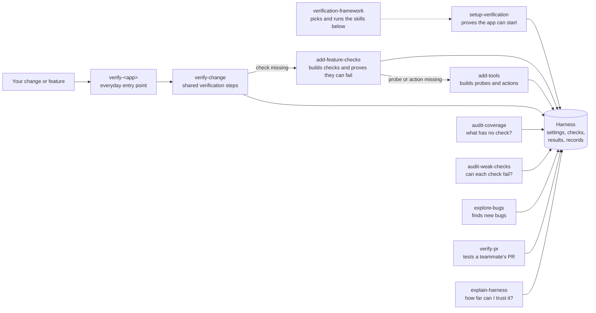

# Use the verification framework

The verification framework is a set of agent skills that let an AI agent prove a code change works on your real, running app, and say plainly when it cannot. Use it when passing unit tests is not enough, because the change crosses a database, another service, a browser, or anything else a unit test replaces with a stand-in.

The skills build and maintain a verification harness in your app's repository: a folder that holds how to start the app, which behaviors to check, the programs that check them, and a saved record of every run. The [README](README.md) covers installing the skills. [Harness internals](docs/internals.md) covers the files and scripts underneath.

## What Verified means

Every behavior the framework tests is reported as Verified, Failed, or Not verified. Verified is a strong claim, backed by four guarantees:

- The check ran on the real app, not a copy with its outside systems faked.
- The result names the exact code version it tested, in every repository the app runs from, and says whether there were edits not yet committed. A version is a Git commit, a short code such as `a1b2c3d` that names one saved snapshot of the code.
- The check has failed when the behavior was broken on purpose. This is called a planned break. A check that keeps passing while the feature is broken cannot tell working code from broken code, so the harness does not trust a check until it has seen it fail.
- The run left a record file, called an evidence file, that anyone can open or rerun.

The harness's `validate.py` script rejects any Verified result its records do not support. [How a behavior earns "Verified"](docs/internals.md#understand-how-a-behavior-earns-verified) follows one example step by step.

A new harness checks nothing yet. Setup only proves the app can be started and inspected. Checks are added afterward, one behavior at a time, and anything without a check is reported as Not verified, never as passing.

## Your first session

This walkthrough sets up a harness for a store app called storefront, adds a check for paying with a saved card, then verifies a change. The agent messages are examples. Every message that needs an answer ends with a `Needs you:` line holding one question and a recommended answer.

### 1. Set up the harness

In the app's repository, ask the agent:

```text
/setup-verification Set up verification for this app.
```

The agent reads the project's startup scripts and documentation to learn how the app starts, and asks only what it could not find, one question at a time. Starting the app on your machine with its own port and data needs no approval. When a step needs you or touches something shared, it tells you first:

```text
I found how to start your app: `docker compose up` in dev/. I'll start it myself, then build and test a readiness check against it.
I won't run `make seed`, which writes to the shared staging database.

Needs you: starting it opens a cloud login only you can complete. Will you sign in when it prompts? I recommend yes; it signs in only this machine. Then I'll start it and build the check.
```

It then creates a folder such as `.agents/skills/verify-storefront/` and builds the doctor: a command that reports whether the app is running and which code it is running, without changing anything. To prove the doctor works, the agent runs it twice, once with the app running, where it must say ready, and once with the app stopped, where it must say not ready. If you started the app yourself and stopping it would disturb your work, it skips the second run and says so.

Setup ends with a short message that the harness is ready and two suggested next steps: run the new `verify-storefront` skill on its own to see what it can check, or add checks for a feature that works today.

### 2. Add checks for a feature

Ask:

```text
/add-feature-checks Add checks for paying with a saved card.
```

Before building anything, the agent previews what it will prove:

```text
Build saved-card payment on main (storefront 4f2a9c1)

Will prove: a returning shopper can pay with a saved card
How: submits checkout through the real checkout API with a saved card; reads back the order and payment records from the database
Won't prove: what the confirmation screen shows
Sources: launch checklist, row 4

Needs you: should a saved card that has expired be rejected before checkout? I recommend yes (launch checklist, row 6). Then I'll build the check with that case.
```

Each behavior is named in plain words. Its short ID, such as `checkout.saved-card`, stays in the harness files. The agent asks about expected behavior only when your requirements or earlier answers leave it open. It never decides product behavior from the code alone, because code shows what the app does, not what it should do.

The agent writes the check. A second agent, which never sees the first agent's reasoning, compares the check with the agreed preview before it runs. Then the agent proves the check can fail:

```text
Planned break: skip saving the payment record in billing/charge.py.
```

It makes that change in a throwaway copy of the repository, never in your own folder, runs the check there, confirms it fails, and deletes the copy. The final report says how many behaviors are now Verified and, for each one, what was broken to prove its check.

### 3. Verify a change

After changing the saved-card code on a branch, ask:

```text
Use verify-storefront to verify my saved-card change.
```

`verify-storefront` is the skill setup created for this app. The agent works out which behaviors the change could affect, shows a preview in the same format as above, and runs the doctor to make sure the running app is on your branch's code. It runs each check, records the results, and reports:

```text
Saved-card change verified on add-saved-cards (storefront 9e1d0b7): 1 Verified, 1 Not verified

- A returning shopper can pay with a saved card: Verified.
- An expired saved card is rejected: Not verified. No check yet.
```

A behavior with no check is reported as Not verified with the reason. Within the scope you agreed to, the agent can build the missing check in the same run, unless you asked for existing checks only.

## Choose a skill

If you don't know which skill you need, type `/verification-framework` followed by what you want, in your own words. It looks at what the repo already has, such as whether a harness exists or setup stopped partway, picks a playbook, and runs the matching skills in order. When it has to do something you didn't ask for first, such as setting up before it can verify, it shows the steps and waits for your yes. For anything with real side effects, the skill it runs still asks first.

Otherwise, start with setup-verification. After that, use the app's own verify skill for everyday work and the others when you need them.

| What you want | Skill | Example request |
| --- | --- | --- |
| Not sure which skill you need | verification-framework | "Did my change work?", "are our checks fake?", "what can this do?" |
| Create a harness, finish one whose setup stopped, or update one after updating the framework | setup-verification | "Set up verification for this repo", "resume setup", "update the harness" |
| Add checks for a behavior | add-feature-checks | "Add checks for checkout", "what should we add next?" |
| Add a probe or action on its own, from scratch or from a script or request you found | add-tools | "Add this script as a tool", "add a way to look up an order" |
| Verify a change or a feature in this app | verify-\<app\>, made by setup | "Use verify-storefront to verify my change", "verify every checkout behavior" |
| Find what the harness does not check, and what no longer matches the app | audit-coverage | "Audit coverage", "what aren't we checking?", "does every requirement have a check?" |
| Find checks that would still pass if the behavior broke | audit-weak-checks | "Audit weak checks", "are our tests fake?" |
| Understand what the harness checks and how far to trust a pass | explain-harness | "Can I trust these checks?", "how is checkout checked?" |
| Look for bugs nobody wrote a check for | explore-bugs | "Run a round of exploratory testing" |
| Test a teammate's pull request on the real app | verify-pr | "Verify PR #123" |

Install verify-change, add-feature-checks, and add-tools alongside setup-verification. verify-change holds the steps every app's verify skill follows, add-feature-checks builds checks when verification finds one missing, and add-tools builds the probes and actions those checks need.

Some skills run only when you call them by name, such as `/setup-verification` in Claude Code: verification-framework, setup-verification, the two audits, explore-bugs, and verify-pr. The agent can start the others on its own. The app's verify skill, verify-change, add-feature-checks, and add-tools start this way so an agent that just changed the app can verify its work. explain-harness only reads, and starts this way so a teammate asking "why should I trust this pass?" gets an answer without knowing its name.

When you call verification-framework, your call is the request, so it can run any skill for you.



## Set up a harness

setup-verification creates a harness, or resumes one whose setup stopped, and proves the app can be started and inspected. It creates no feature checks.

1. It works out which app to cover from your request and the project's configuration. In a repository holding several apps, it finds the one you named. If the app's code lives in other repositories, it follows the references to them. When two harnesses or apps could match, it asks which.
2. It confirms verify-change is installed, then creates the harness folder right away with setup marked unfinished. Progress is saved from the first step, so a later session can pick up where this one stopped.
3. A second agent reads the startup scripts, required tools, ways to tell the app is ready, related repositories, and where requirements are written. It only reads and changes nothing. You are asked only what the project could not answer.
4. When a step needs a person or has an effect outside your machine, the agent shows the setup note from the walkthrough above and waits for you to confirm it. The note says how it will start the app, what needs you, and what it will not run.
5. It fills in the harness's settings and creates the app's verify skill, an empty feature list, the doctor, a guide to the harness's commands, and a folder for records. It does not edit your Git ignore files or decide which harness files your team keeps in Git.
6. It starts the app the way the project normally does, or asks you to start it when only a person can, and proves the doctor works. Setup is marked ready only after the doctor's output is saved and `validate.py` passes.

At the end, it asks permission to add one line to your project's agent instructions pointing to the harness's command guide, so any agent debugging the app can find the commands. If you decline, the guide still exists, and the report says other agents will not find it on their own.

### One harness or several

Start with one harness for the app or system you want to verify. One harness can cover many features and code spread across several repositories. Separate folders, services, or test entry points do not need separate harnesses.

When the app is one folder of a larger repository, setup puts the harness in that folder's skills directory. Its commands then run from the app's folder, and edits elsewhere in the repository don't mark a run's code as changed.

Use separate harnesses for apps that are run separately, with different scopes and different startup or access needs. For example, a commerce repository could hold:

```text
commerce/
├── apps/
│   ├── storefront/
│   └── admin/
├── services/orders/
└── .agents/skills/
    ├── verify-storefront/
    └── verify-admin/
```

- `verify-storefront` covers shopping, checkout, and order confirmation, as a shopper uses them through the storefront and the orders service.
- `verify-admin` covers staff order search, refunds, and permissions, as staff use them through the admin app and the same orders service.

The two harnesses can share a probe that looks up an order. A change to the shared orders service may need checks from both, so name both apps when you ask for verification. A pass in storefront does not show that admin works.

### Resume a stopped setup

Setup stops and saves what it learned, rather than guessing, when:

- It cannot find how to start the app. It says where it looked and asks how you normally run it.
- It finds several ways to start the app. It explains the difference and asks which matches how you work.
- A related repository is missing, or a step needs your personal login. It asks for the location or the action. It never asks for or saves passwords or other secret values.
- There is no way to run the app locally. It asks whether there is an existing environment you want to use, or whether you want help creating one. Creating an environment is separate work. A shared environment needs your approval for anything the agent does there, and it must be able to report which code it is running.

Run setup-verification again to resume. It reads its saved notes, checks that they are still true, and continues from the saved next step. It does not reuse approvals you gave in an earlier session.

While setup is unfinished, every other skill stops at the start with the reason setup stopped and the step that would resume it.

### Update a harness after updating the framework

Each harness keeps its own copy of the shared rules and the framework scripts, and updating the skills leaves those copies alone. Run setup-verification in the repo after every framework update. Before anything else, it replaces each copy that differs from the installed framework's, names the files it replaced, and runs `validate.py`. When you asked only to update, it stops there without starting the app. Otherwise it goes on to resume setup or prove readiness as usual.

It stops instead of copying in two cases. If the harness's rules are newer than the installed skills, it asks you to update the skills. If the harness's rules were edited, it shows the edit and asks before restoring the shared version, since anything specific to one app belongs in `settings.md`.

### Harness files

| File | What it holds |
| --- | --- |
| `README.md` | Where a person starts: what the harness is, how to run a check, where results and recordings are |
| `recordings.html` | Each check's latest run first, with its history and any videos, to search and watch |
| `settings.md` | This app's repositories and the commands that start, stop, check, and inspect it |
| `status.md` | Setup notes and the latest result for each behavior |
| `features/` | One file per feature, listing its behaviors and how each is proven |
| `tools.md` | A guide to every command in the harness, usable outside verification too |
| `scripts/` | The doctor, the checks, and the app's other tools |
| `scripts/framework/` | Five framework scripts, copied unchanged |
| `evidence/` | One folder per check holding the record of each run, plus the doctor's saved output in `doctor/` |
| `rules.md` | The shared rules every harness follows, copied unchanged |
| `SKILL.md` | The app's verify skill, which points verify-change at this harness |

Do not edit `rules.md` or anything in `scripts/framework/` (`validate.py`, `code_state.py`, `break_session.py`, `replay.py`, `clip.py`). They are identical in every harness, so a newer version can replace them in one step and anyone who knows one harness can read another. Your team decides how long to keep records and whether to store them in Git. [Harness layout](docs/internals.md#harness-layout) lists every file.

## Add checks for a feature

add-feature-checks builds the programs that test a behavior and proves each one can fail. Use it in a harness whose setup is finished.

Name what you want, such as "add checks for checkout". The agent previews first, as in the walkthrough: the behaviors in plain words, how it will use the app, what it will read back to judge the result, what it will not prove, and the requirements or answers that set the expected behavior. The agreed plan is saved in the feature's file, with links to those sources.

Ask "what should we add next?" to get three to five suggestions, with one recommended. The agent looks at the harness and, when an issue tracker is connected, at recent bug reports. It builds nothing until you pick.

### Five kinds of tool

The agent can build five kinds of tool. It builds probes and actions through add-tools, described below.

| Tool | What it does |
| --- | --- |
| Check | Uses the app the way a user would, then reads back every result to judge it. Not trusted until it has failed on a planned break. |
| Probe | Answers a question about the app's current data, such as `probe order o_123`, and changes nothing. |
| Action | Does something a user or operator would do, through the same button or web address they use. An action that affects anything outside your machine or anything shared refuses to run without `--user-approved`. |
| Invariant | A rule that must always hold no matter what happened, such as "a paid order has exactly one payment", written as code so every check and probe judges it the same way. |
| Scenario | A check that walks a whole user journey across several features. |

Every tool reads results directly from the database, the raw web response, or the screen, never through the app's own code. If a tool asked the app's code whether an order was paid, a bug in that code could make a broken feature look fine.

### Where a check starts

One harness can hold checks that start at different points. For an app with a web page, a gateway in front of it, and a server behind that:

- A check that starts in the browser uses the page the way a user does, then reads what the page shows and what was stored. It can prove a user completes the task and sees the right result.
- A check that starts at the gateway calls its web address directly, then reads the response and what was stored. It can prove the gateway and server behave correctly, but not what the user sees.

For a change to how the gateway routes requests, ask for the gateway checks. For a change to the checkout experience, ask for the browser journey. The preview always names where the check starts and what it cannot show. Nothing picks between these automatically, so name the one you want.

### Planned breaks

Before each planned break, the agent tells you `Planned break: <the change>`. A framework script copies your code, uncommitted edits included, into a throwaway copy, points the app at it, and saves the change as `break.patch` beside the run's record. Afterward it points the app back and removes the copy. The time between is called a break session.

While a break session is open, ordinary verification cannot record code versions, even when told to read the code from another folder, and other harnesses using the same Git repository must wait until the harness that opened the session ends it. The doctor must still confirm which code the app has loaded, because restoring files does not restart a process or undo data changes. If the app can't run another copy of its code, the break is reported as blocked.

A break counts only for the behavior it was aimed at, and only when a step checking that behavior failed. Breaking payment can make a later receipt step fail too, but that proves nothing about the receipt. If a step that caught the break is later renamed, removed, or changed, the planned break is run again.

### What the report says

The report opens with how many behaviors are now Verified, then gives one line per behavior: what was broken to prove its check, or why it is not proven yet. It also names any expectation the agent changed in a check after you agreed to the plan, and any test data left somewhere shared, such as a test payment account. Commands, versions, and workarounds go in the harness files, not the report.

A check for behavior your team wants but has not built yet stays in the harness and keeps failing, with the ticket that tracks the work. add-feature-checks does not build the feature itself.

## Add a tool on its own

add-tools adds a probe or action before any check needs it, so later checks and agents can use it. Ask for something like "add this script as a tool", "let agents look up an order", or "find the request the order history page makes to load an order and turn it into a probe."

Give it a script, a request you already found, such as an undocumented GraphQL query, or a way to find one, such as watching the browser's network requests. The agent keeps the request your source found, rewrites the rest to the harness's rules, and proves it on the real app. A separate agent reviews each tool against the rules before it runs.

A tool reads passwords and tokens from your project's settings, never from a captured request. When the project has no setting for one yet, such as a third-party API token or a browser session cookie, set it yourself as an environment variable or in your untracked `.env`. The tool guide names the variable, how to get it, and when it expires, and the tool stops and names the variable when it's missing. `validate.py` rejects a guide entry with missing fields, and a tool with a password or token written into it.

The agent adds the tool to the tool guide with where its request came from, and warns that an undocumented request may change without notice. A probe that reads the app's own API notes that the answer comes from the app's code, so a check about what that endpoint does reads the database instead.

A tool on its own judges nothing, so there is no preview of behaviors and no planned break. The agent lists each tool in one line with what it reads or does and what it is allowed to change, and asks first when a tool can change anything.

An action normally touches only records the harness created. To act on a real record, such as refunding one customer's real order, name that record. The agent passes its ID along with `--user-approved` for that run only.

## Verify a change

Use the app's verify skill, such as `verify-storefront`, to verify a change or a whole feature:

- "Use verify-storefront to verify my saved-card change."
- "Use verify-storefront to verify every checkout behavior."

The app's verify skill points verify-change at the right harness, and verify-change does the work. Calling verify-change directly runs the same steps, no broader. Do that when the app has no verify skill: "Use verify-change with .agents/skills/verify-storefront to verify my saved-card change."

With no change or feature named, verify-change lists what the harness can check, with each behavior's latest result, and marks the ones your current changes touch. It runs nothing until you pick. An agent verifying its own change names the change and skips the list.

verify-change goes through these steps:

1. It runs `validate.py`. If the harness's copy of the shared rules was edited or comes from another framework version, or setup is unfinished, it reports why and stops. It then saves a copy of the harness to compare against later.
2. It traces your change through the code to find every behavior it could affect, including other features that use the changed code. It shows the preview and asks about expected behavior only when your request and requirements leave it open.
3. For a behavior with no check, it shows what it would build and has add-feature-checks build it, within the scope you agreed to. If you asked for existing checks only, a missing check stays a reported gap. Anything that needs your answer, a permission you have not given, or a much larger scope pauses the work that depends on it, while unrelated checks keep going.
4. It runs the doctor. It tests only an app that is ready and running your requested version in every repository the behavior depends on. If the app is not running, it starts it only when the harness's settings allow, and asks you when starting needs a login, a prompt, or your approval. If the app is running other code, it stops and says so, rather than restarting an app it did not start.
5. It runs each behavior's check and confirms the check actually tests the agreed behavior. It never swaps in a different route to the same result, and it never treats a failing check as a missing one.
6. After the last check it compares the harness with its saved copy. If anything changed outside add-feature-checks' work, the report opens with "Harness edited during this run" and the changed files, and every behavior whose check changed is Not verified until add-feature-checks proves it again.
7. If your change adds or alters a behavior, it updates that feature's file in the same change.
8. It records each result with the version tested, confirms every Verified result against its record with `validate.py`, and stops only the processes it started.

The report uses the same wording for each behavior as the preview did, and puts what went wrong before what passed. A Failed behavior that was recorded on video links its replay page. After a passing check that drove a screen, the agent offers to cut a short video clip of the changed behavior for your pull request, or, when this computer cannot make clips, shows how to install the tools for it.

## Ask how far to trust a pass

explain-harness is for someone who didn't build the harness and didn't watch it run. It only reads: it never starts the app, runs a check, or edits a file. It answers the same five questions for every check:

1. Does it do what a user does?
2. Does it look at the result itself, rather than asking the app?
3. Have we seen it catch a problem? Someone broke the app on purpose and the check failed.
4. Did it run on the code you care about?
5. Can you see the proof?

Ask with no question and it walks one real check through those five, tallies where trust is weakest, and suggests two or three things to ask next. Name a feature or a pass and it answers for just those checks. Ask for a page to share and it writes one HTML page outside the repo. It points a weak check to audit-weak-checks and a missing one to add-feature-checks.

## Keep the harness honest

A harness can drift from the app over time: features change, checks get edited, and new bugs appear that no check covers. Four skills look for this. Each ends with a short report, and each asks before committing, posting, or running anything that affects something outside your machine.

### Find what has no check

audit-coverage answers "does this harness cover the app as it is today?" It:

1. Runs `validate.py` and fixes any formatting problems in the feature files.
2. If the app has a written requirements source, splits each requirement into its smallest testable parts and matches each one to a check. A requirement with no check gets a new behavior marked "No check yet".
3. Has one agent per feature read the app's code, without running or editing anything, to find where the feature files no longer match it.
4. Runs every feature's checks on the real app, and runs the planned break again for any check whose code changed since it was proven.

Each problem it finds goes into one of three groups. A feature file that describes the app wrongly gets fixed. A tool that cannot test working behavior gets fixed and rerun. A bug in the app gets reported with its record, never hidden.

The audit ends as clean, changed, or blocked. It proposes edits to your requirements document rather than making them.

### Find checks that cannot fail

audit-weak-checks answers "would each check go red if the behavior it guards broke?" It never runs the app or touches shared systems. It:

- Makes each rule-checking function in a throwaway copy always answer "nothing is wrong", then runs the unit tests to see whether any test notices.
- Looks for tests that check nothing, tests that are switched off, and checks that were removed or weakened since the last audit.
- Has one set of agents look for problems and a separate set confirm each one without seeing how it was found.

It fixes clear-cut problems in your working copy, with a test shown failing before the fix and passing after, and leaves them uncommitted. Its report offers to commit them under a title that starts with `Audit harness checks`, so the next audit knows where to start. It never relaxes a test to make it pass.

### Look for bugs nobody wrote down

explore-bugs runs one round of exploratory testing. A round picks one kind of change and tries three to six new cases of it on the real app. The kinds are:

- Timing: two actions at once, a slow response, a retry.
- Order: acting after a task ended, or before a record exists.
- Identity: a second tab, a second account, an admin acting as a user.
- Input shape: empty, very long, or unusual text, or odd files.
- Lifecycle: reloading mid-task, a session expiring, a restart between steps.
- External side: what an outside system can do on its end, such as sending the same event twice.
- Code reading: reading recent changes to find paths no check covers.

The harness needs at least three invariants, the always-true rules described above, so the round can judge states no one predicted. If it has fewer, explore-bugs offers to have add-feature-checks build them.

A suspected bug is confirmed by running it again and pointing to the line of code that causes it. When that is not possible, it is run three times and a separate agent tries to explain it away. Each confirmed bug becomes a failing check, and the agent drafts an issue for your tracker, filed only when you say yes.

Each round starts with no memory of earlier ones, so the round is saved to a ledger, a running log the next round reads first so it does not repeat work. The agent can search all past rounds. It logs test resources as soon as they are created, so an interrupted round still shows what needs cleanup.

A new combination of known failures does not count as a discovery. After three rounds in a row find no new failure or anomaly, the next round reads recent code changes instead of trying more variations. explore-bugs never reports "no bugs found". It reports what it covered.

Now and then, run a calibration round to test the loop itself. A separate agent plants a known bug without saying where, and the round has to find it.

### Test a teammate's pull request

verify-pr tests a pull request on the real app, or several pull requests across repos that make one change, such as a frontend and a backend pull request, tested together as one. It lists every fix and test case the pull requests claim, any acceptance criteria from its linked ticket that the description misses, and any change a user could notice in its code that neither one mentions. It sorts each one:

- Add: the result depends on two or more parts of the system agreeing, and no current check covers it.
- Already covered: an existing check proves it, and will be rerun on the pull request's code.
- Add with a missing step: it belongs in the harness, but no current check reaches that situation yet.
- Skip: one part of the system decides the result alone, so that part's own unit tests are the right place for it.

You approve the list. The agent checks out each pull request in a git worktree of its own, a second checkout beside yours, so your checkouts stay as they are. It builds only the approved checks on a new branch, `verify-pr/<number>-checks`, runs them with every pull request's code loaded together, and sorts each failure: a defect in the pull request, a failure already tracked elsewhere, a problem in the harness, a flaky run, or a failure it cannot place yet.

It drafts a comment, the same one for each pull request, and posts it only when you say so. When a check that shows the changed behavior on screen passed, the draft comes with a short demo video of only the steps that show it, with no captions, and the agent checks still images of it for anything that shouldn't be public first. The demo goes on the pull request that changes the screen.

At the end it offers to open a pull request for the new checks, into the pull request in the harness's repo when there is one, so the checks merge with the code they test, and to remove the worktrees it made. Removing a worktree keeps the checks branch.

## Read results

### Messages

Every skill writes its messages the same way. A message is a question, a plan for you to approve, or a report.

A message that needs your answer ends with a short `Needs you:` line: one question that names what it asks about, the recommended answer with its reason or source, and what the agent does next. Nothing comes after it, so the last line of a message always tells you whether the agent is waiting on you. In a report, that line opens with the outcome. When your agent can show a list of choices, a question with a few known answers appears as that list, with the recommended choice first. A message with no `Needs you:` line is for information only.

A preview always has the same lines, in this order: Will prove, How, Won't prove, Gaps, and Sources. A line with nothing to say is left out, and the whole preview fits in 12 lines.

A report opens with the outcome, puts what went wrong before what passed, and gives only what you need to act on, in 12 lines or fewer. Versions, commands, and record paths stay in the harness's `status.md`. A caveat, such as an uncommitted file, is said once per session.

### Verdicts

Every behavior is reported with one of three verdicts.

- **Verified.** Every step passed on the named version without the run stopping, and the same check was shown to fail on a completed planned break aimed at that behavior, in a step that checks it. Both records identify every configured repository, and uncommitted code is identified by a fingerprint of its content. The result names the check, its level, where it started, its record, and the code version.
- **Failed.** A step of its check failed. The result names the step and what it found, with a replay page when the run was recorded.
- **Not verified.** It was not proven. The result gives the reason: a missing check, or a blocker such as a missing account and what was tried.

The last result line for a behavior in `status.md` is its current verdict, including a Failed or Not verified line without a saved run.

Keep these limits in mind when reading results:

- A pass counts only for the version it ran on. A pass on `main` says nothing about your branch.
- A check that reads only stored data does not prove what the user saw on screen.
- A run that only looked around or stopped early has no verdict. It is never a pass.
- A check marked `Not break-tested` has not been shown to fail, so its passes cannot be trusted yet.

Feature files describe what the app should do. `status.md` records what happened on each run, including known failures, passes that can mislead, and cases nobody has tested. Read it first.

### Levels of proof

The framework sorts proof into four levels. Each level proves more than the one before and costs more to run. A check uses the lowest level that can prove the behavior, and every result names its level.

| Level | Who can run it | What it can prove |
| --- | --- | --- |
| 1. Unit | The agent, always | The code's own logic, with outside systems replaced by stand-ins |
| 2. Local app | The agent, once the doctor says the app is ready | Reads and actions on a local instance, with results read back from stored state or the screen |
| 3. Real system | The agent, only with your approval | Behavior that reaches a real outside or shared system, such as a payment provider |
| 4. Human action | You, or an operator's real tools | Anything only a person can start |

A level cannot prove anything about a system it replaced with a stand-in. When a behavior needs a higher level than the run could use, it is reported as Not verified, with the level that would settle it. The [rules](skills/setup-verification/references/rules.md#lanes) call these levels lanes.

### Recorded runs

A check that uses a screen records a video. It keeps the video when the run fails or when you ask, by telling the agent or by setting `VERIFY_KEEP_RECORDING=1` when you run the check yourself. Each run's record notes when every step began and when each pass or fail was decided, so the video can be cut by step.

To see how the checks are doing, open `recordings.html` in the harness. Setup creates it, the feature map links to it, and every check run updates it. A run that keeps a video prints its path, as does the agent's report.

Each check gets one line for its latest run, failing checks first. The line is titled with the check's feature and a sentence on what the feature does, and shows the result, the first failed step or the reason the run stopped, how many steps failed, and when it ran. The result is Failed, Passed, or Didn't finish, which means the run ended before it could decide, such as when the browser crashed, and so has no verdict. A Didn't finish line says whether any step had failed before the run stopped. A check whose run used different code from the newest run is marked "Earlier code". When the run kept a video, a Watch button opens it a few seconds before the failure, or where the run stopped.

Details opens the rest: every failed step with what it read, the behaviors the run judged, each repo's branch and commit, the earlier runs, and the replay page, which has the video, the whole timeline, and the evidence. Filter to failed, unfinished, or passing checks, or type in the search box at the top, such as a branch name or a step like "payment". The page leaves out planned-break runs. The feature map links each one from the behavior it proves.

Two scripts work on a single run:

- `scripts/framework/replay.py <record>` makes a replay page. The video sits beside a list of the run's steps. Click a step to play it and see what it read, and press `j` or `k` to jump between failures.
- `scripts/framework/clip.py <record> --steps 2-3` cuts those steps into a short MP4 with captions, ready to attach to a pull request. The file is named for what it shows, such as `checkout-pay-steps-2-to-3-customer-pays-2026-10-03-1402.mp4`, so it still makes sense once attached or downloaded. Add `--no-captions` to leave the captions off.
- `scripts/framework/clip.py <record> --steps 2-3 --demo` cuts a demo for reviewers: no captions, each wait where the screen holds still cut to a second, the result held on screen at the end, and small enough to upload to GitHub. verify-pr makes these.

Clips need ffmpeg, a common video tool, and captions need Chrome, Chromium, or Edge. `scripts/framework/clip.py --check` says whether this computer can make clips and how to install what is missing. See the README's [Requirements](README.md#requirements).

Agents do not watch the video. A failed step also saves a screenshot and the page's text at that moment, and the run saves the browser's errors and failed requests with their times. An agent works out the failure from those first, then from a few still images: `scripts/framework/clip.py <record> --frames failed` saves images from just before, at, and just after each failure. The replay page and clips are for people.

## Use the tools while debugging

The harness's tools are ordinary command-line programs in your project's language, kept in the harness's `scripts/` folder. Use them while debugging, without starting a verification skill. A probe, for example, answers "what state is order o_123 in?" without hand-writing a database query.

`tools.md` describes each command: when to use it, how to run it, what it needs, what it is allowed to change, what its output means, and what it cannot show. Every command answers `--help` without connecting to anything or changing anything.

Tools reuse what your project already has. Checks can call existing project commands instead of copying them, and new tools use your project's database drivers and connection settings. They need no extra server or special command format.

add-feature-checks suggests a layout for this code: one module that connects to your systems, one that reads results, one for invariants, one wrapper for each system a user touches, a shared recorder that writes each run's record, and thin commands on top. A project that already organizes this code its own way keeps its layout.

A probe's answer describes the app's current data. It is not a Verified result on its own, because nothing proved a check behind it can fail.

## Glossary

- Skill: a set of written instructions an AI agent loads to do one kind of job.
- Verification harness: the `verify-<app>/` folder in your repository that holds the app's settings, feature list, checks, results, tool guide, tools, and records.
- Repository: one Git project folder. An app may run code from several.
- Commit: one saved snapshot of the code in Git, named by a short code such as `a1b2c3d`.
- Settings: the harness's `settings.md`, which records everything specific to one app: its repositories, where its requirements are written, and the commands that start, stop, check, and inspect it.
- App verify skill: the skill setup creates for one app, such as `verify-storefront`. It is the everyday way to verify a change to that app, and it points verify-change at the app's harness.
- verify-change: the shared skill that holds the verification steps every app's verify skill follows.
- Feature map: the files in `features/` that list each feature users see, the behaviors in it, and how each behavior is proven.
- Sub-feature: one behavior a user would notice, such as paying with a saved card, with a short ID such as `checkout.saved-card`.
- Check: a program that uses the app the way a user would, then reads back what happened to judge the result.
- Evidence file: the saved record of one check run, with each step's result and the code version tested.
- Planned break: the smallest deliberate change that makes a behavior wrong, made in a throwaway copy of the code to show that its check fails.
- Doctor: a command that reports whether the app is running and ready to test, and which code it is running, without changing anything.
- Probe: a command that answers a question about the app's current data without changing anything.
- Action: a command that does something a user or operator would do, through the same entry point they use.
- Invariant: a rule that must always hold no matter what happened, written as code.
- Lane: one of the four levels of proof: unit, local app, real system, or human action.
- Results file: `status.md` in the harness, with the latest result for each behavior, known failures, passes that can mislead, and cases nobody has tested.
