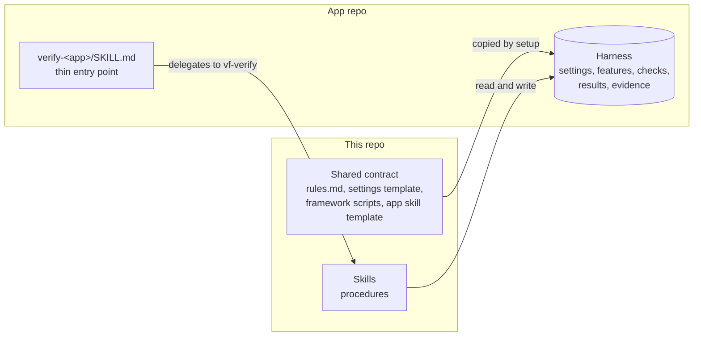
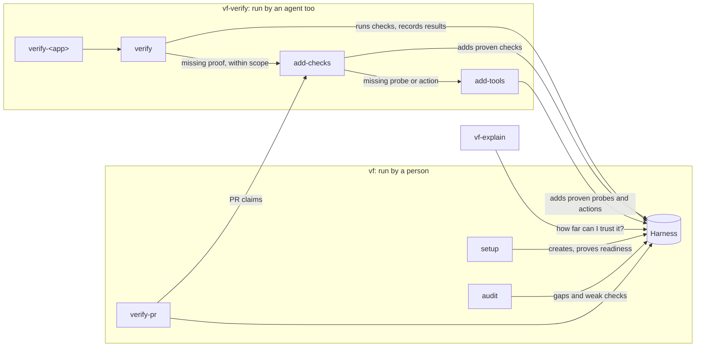

# Architecture

The framework has two parts. This repo publishes the skills and one shared contract. Each app's repo gets a **verification harness**: the folder holding that app's settings, tools, checks, results, and evidence. Skills hold the procedures, the contract defines what a pass means, and the harness holds everything specific to one app.

Use this page to decide where a change belongs. [USAGE.md](../USAGE.md) covers what a person running the skills sees, [internals.md](internals.md) the harness's files and scripts, and [design.md](design.md) open questions and decision records.

## The two parts

This repo holds three skills in `skills/<name>/`: **vf** for the jobs a person starts by name, **vf-verify** for the jobs an agent may start for its own change, and **vf-explain**, which only reads ([ADR 0002](adr/0002-three-skills.md)). Each job is a mode with its procedure in the skill's `references/`. The shared contract lives in vf's `references/` and `scripts/`, because vf's setup mode is what copies it into a harness. Setup also commits a copy of each skill, without `scripts/`, beside the harness, so a clone of the app's repo is the install ([ADR 0007](adr/0007-the-framework-ships-inside-the-app-repo.md)).

A harness is a `verify-<app>/` folder in one of the app's skills directories. The folder holding that skills directory is the **project root**: the repo's top folder for a single-repo app, or the app's own folder in a monorepo. Commands run from it and settings resolve from it ([ADR 0001](adr/0001-one-harness-per-app.md)). One harness can cover an app that spans several repos.

## Layers of the contract

Each fact has one home. Put a change in the layer that owns it.

| Layer | Owns | Lives in | Who changes it |
| --- | --- | --- | --- |
| Rules | What a pass means, the evidence and feature map formats, report words, harness layout | `rules.md`, copied unchanged into every harness | This repo only |
| Message shape | How every skill asks, previews, and reports | `references/messages.md`, identical in vf and vf-verify | This repo only |
| Settings | How this app starts, is driven, and is read | Harness `settings.md`, from the template | Setup, then the team |
| Procedure | The steps for each job | The skills in this repo | This repo only |
| Entry point | Which app and which harness | Generated `verify-<app>/SKILL.md` | Setup |
| Harness artifacts | Feature map, results, tool guide, tools, checks, evidence | Fixed folders inside the harness | The skills, at run time |

Every harness gets an identical `rules.md`, so anyone can check it for edits, upgrade it by swapping one file, and read any harness once they know the rules. Anything that differs by app is a blank in the settings template, never a variation in the rules.

### The framework scripts

Two terms used throughout: the **doctor** is the harness's readiness check, a command that confirms the app is up and running the requested code. A **planned break** is a deliberate bug, made in a scratch copy of the code, that a new check must catch before its passes count.

Setup copies nine Python scripts unchanged into each harness's `scripts/framework/`: the ones a run, a verdict, a launch, or a replay needs, plus `locate.py` and `trust_facts.py`. `vf.py` is the one command people and skills call for runs and records; the scripts below sit behind it, and the skills run `locate.py` and `trust_facts.py` by path. The three audit scripts stay in the installed vf ([ADR 0012](adr/0012-vendor-only-what-bears-trust.md)).

| Script | Job |
| --- | --- |
| `vf.py` | The command-line entry point. `run` runs the doctor, then one check, and writes its evidence. `status` computes every verdict and writes `status.md`. `sync` creates and updates a harness's framework copies ([ADR 0006](adr/0006-one-versioned-tool-writes-every-record.md)) |
| `validate.py` | The machine-readable side of the contract: checks settings, the feature map, the setup gate, and that every Verified line is one it would write now ([ADR 0004](adr/0004-judge-from-outside-and-compute-verdicts-from-evidence.md)) |
| `code_state.py` | Reports each repo's commit, branch, and uncommitted changes, so every record means the same thing by "version" |
| `break_session.py` | Runs a planned break in a scratch copy of the code and restores it afterward ([ADR 0005](adr/0005-credit-a-planned-break-only-to-what-it-broke.md)) |
| `launch.py` | An optional launcher and doctor for an app that runs straight from its checkout |
| `replay.py`, `clip.py` | Turn a run's evidence and video into a replay page, the recordings page, and clips |

## Who owns what

| Skill and mode | Owns | Writes |
| --- | --- | --- |
| vf, setup | A harness whose startup and doctor are proven on the real app. Ends with zero feature coverage | Skeleton, settings, doctor, setup record |
| vf, audit and verify-pr | Finding where an existing harness has drifted from the app, and testing a teammate's pull request | Harness fixes, findings, drafts |
| vf-verify, verify | Running proof for a change or named feature on the requested version | `evidence/`, and `status.md` through `vf.py` |
| vf-verify, add-checks | Feature checks, each agreed with the user and proven to fail on a planned break | Feature files, `scripts/`, `tools.md` |
| vf-verify, add-tools | Probes and actions, each proven on the real app | `scripts/`, `tools.md` |
| vf-explain | Telling someone what the harness checks and how far to trust it | Nothing in the repo |

Three hand-offs carry most of the design ([ADR 0002](adr/0002-three-skills.md)):

1. **Setup stops at readiness.** Proving the environment and building feature proof are separate jobs.
2. **The app entry point stays thin.** It names the harness and delegates. The procedure lives once, in vf-verify's verify mode, so a fix reaches every app.
3. **Verification delegates missing proof.** The verify mode hands coverage it lacks to the add-checks mode, inside the agreed scope. A request for existing checks only turns missing coverage into reported gaps.

vf's audit mode for weak checks and its verify-pr mode also work on a harness this framework didn't create, so they carry the few rules they need instead of relying on `rules.md`. Where the weak-checks rubric states a rule `rules.md` already has, it repeats the sentence word for word, and `tests/test_rubric.py` keeps the copies identical.

## A verification run

1. The user asks `verify-<app>` to verify a change. It loads vf-verify in verify mode with its own directory as the harness.
2. The verify mode runs `vf.py validate`. Incomplete setup stops here with the saved blocker.
3. It previews the behaviors, actions, observations, and exclusions, and asks only about expected behavior it had to infer.
4. Missing proof goes to the add-checks mode: agree on a plan, build the check, have a separate reviewer compare check to plan, and prove the check fails on a planned break in a scratch worktree.
5. The doctor confirms the running app is ready and on the requested code in every repo.
6. Checks drive the app through its real entry points and read results from storage, responses, or the screen, never through app code ([ADR 0004](adr/0004-judge-from-outside-and-compute-verdicts-from-evidence.md)).
7. Each check reports its steps as events. `vf.py run` writes the evidence file from them and refreshes `status.md` ([ADR 0006](adr/0006-one-versioned-tool-writes-every-record.md)). The verify mode records any behavior it couldn't run with `vf.py not-verified`.

## Rules every skill shares

- Skills find a harness by looking for `verify-*/rules.md` in the skills directories of the current folder and each folder above it, up to the repo's top level. Keep that marker stable.
- A harness keeps all artifacts in fixed folders. Settings can't move them ([ADR 0001](adr/0001-one-harness-per-app.md)).
- Skills and `validate.py` support only the current harness format. An older harness fails `validate.py` ([ADR 0001](adr/0001-one-harness-per-app.md)).
- Every skill passes the Rules version it was written for to `vf.py validate --written-for`, which fails on a mismatch and names the side to update, so a personal install can't run another procedure against the repo's harness unnoticed ([ADR 0007](adr/0007-the-framework-ships-inside-the-app-repo.md)).
- The framework adapts to a project by finding what it already has (start scripts, clients, requirement docs), not by adding options. Generated tools use the project's own language.
- The main agent synthesizes and decides. Subagents on a mid-tier model gather evidence: discovery during setup, the plan reviewer, per-feature readers in the audit, check readers in vf-explain.
- Product code changes only in scratch worktrees. Skills drive and stop only app instances they started or the user named. Anything with a real or shared side effect needs the user's OK, and a harness action refuses to touch anything shared without `--user-approved`.

## Where a change goes

| You want to change | Edit |
| --- | --- |
| What a pass means, the evidence format, or the report words | `rules.md`, the settings template, `validate.py`, USAGE.md, and internals.md, together |
| The message shape | Both copies of `references/messages.md`, kept identical, and USAGE.md |
| Something only some apps need | A blank in the settings template, not a rule |
| How one job is done | That skill's `SKILL.md` and its `references/`, then the eval smoke tier (`evals/README.md`) |
| Who does which job | The modes involved, USAGE.md, the README index, and an ADR |
| Which skills or modes exist, or their names | The skill folders and `references/mode-*.md`, the README index, USAGE.md, vf's playbooks (the ordered lists of modes it runs for a request), and `locate.py` |
| A large or hard-to-reverse decision | A new ADR in `docs/adr/`, linked from design.md |

A change to a script's formats or output also updates [internals.md](internals.md). [AGENTS.md](../AGENTS.md) has the repo rules and skill conventions.
