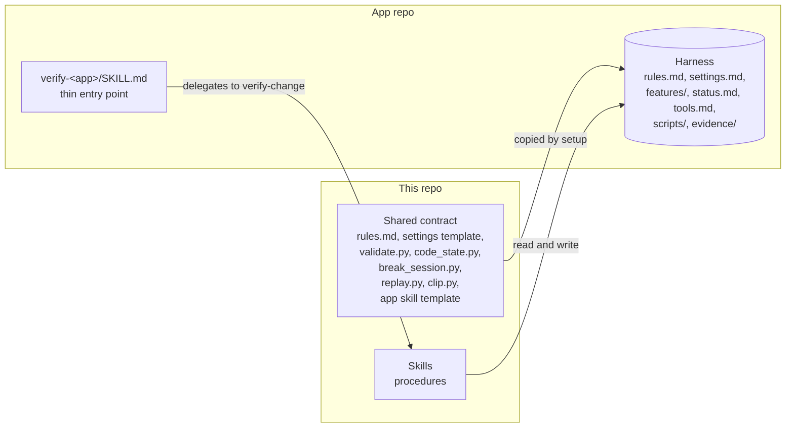
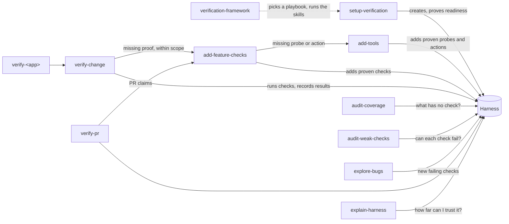

# Architecture

The verification framework has two parts. This repo publishes skills and one shared contract. Each app's repo gets a verification harness, the folder that holds that app's settings, tools, checks, results, and evidence. Skills hold the procedures, the contract defines what a pass means, and the harness holds everything specific to one app.

Use this page to decide where a change to the framework belongs. See [USAGE.md](../USAGE.md) for what a person running the skills sees, [internals.md](internals.md) for the harness's file formats, evidence, ledger, and scripts, and [design.md](design.md) for open questions and decision records.

## Understand the two parts

This repo holds nine skills in `skills/<name>/`, installed through the `skills` CLI or as a Claude Code plugin. The shared contract lives in setup-verification's `references/` and `scripts/` because setup is the skill that copies it into a harness.

A harness is a `verify-<app>/` folder in one of the app's skills directories. The folder holding that skills directory is the project root: the repo's top folder for a single-repo app, or the app's own folder in a monorepo. Recipe commands run from it and settings resolve from it ([ADR 0016](adr/0016-anchor-a-harness-on-its-project-root.md)). The harness folder is both an agent skill, the generated entry point, and the data every other skill reads. One harness can cover an app that spans several repos.

## Understand the layers of the contract

Each fact has one home. Put a change in the layer that owns it.

| Layer | Owns | Lives in | Who changes it |
| --- | --- | --- | --- |
| Rules | What a pass means, evidence format, feature map format, report words, harness layout | `rules.md`, copied unchanged into every harness | This repo only |
| Settings | How this app starts, is driven, and is read: repos, commands, lanes, setup status | Harness `settings.md`, from the template | Setup, then the team |
| Procedure | The steps for each job: setup, building proof, verifying, auditing, exploring, and explaining | The skills in this repo | This repo only |
| Entry point | Which app and which harness | Generated `verify-<app>/SKILL.md` | Setup |
| Harness artifacts | Feature map, results, tool guide, tools, checks, evidence | Fixed folders inside the harness | The skills, at run time |

Every harness gets an identical `rules.md`, so anyone can check a harness for edits, upgrade it by swapping one file, and read any harness once they know the rules. Anything that differs by app is a blank in the settings template, never a variation in the rules.

The doctor is the harness's readiness check: it confirms a running instance is ready and is running the requested code. A planned break is a deliberate bug, made in a scratch copy of the code, that a new check must catch.

Setup copies five scripts unchanged into each harness's `scripts/framework/`, apart from the app's own tools:

- `validate.py` is the machine-readable side of the contract. It validates settings labels, the feature map's format, that named commands exist, the setup gate, and that every Verified result agrees with its evidence and a break-tested check ([ADR 0006](adr/0006-back-every-verified-with-its-evidence.md)). Exit code 0 means OK, 1 means it found a problem, and 2 means it could not run, including when setup is still incomplete.
- `code_state.py` reports each repo's commit, branch, dirty state, and uncommitted-content fingerprint ([ADR 0014](adr/0014-identify-uncommitted-code-by-content.md)). Every tool that records which code ran takes its Git facts from it, so a result's commit and dirty state mean the same in every harness ([ADR 0006](adr/0006-back-every-verified-with-its-evidence.md)).
- `break_session.py` runs every planned break in a scratch copy of the code under test, saves the edit beside the run's evidence, and restores the copy afterward. While a session is open, `code_state.py` refuses ordinary code recording, including checkout overrides. Only the harness that opened the session may record its scratch code or end it. The app's doctor still establishes which code its processes loaded ([ADR 0018](adr/0018-run-planned-breaks-through-a-session-script.md)).
- `replay.py` and `clip.py` read only the evidence format and the video it names, so every harness's recordings replay and cut the same way whatever the app's language.

Each check's runs sit in their own folder under `evidence/` ([ADR 0015](adr/0015-a-harness-layout-people-can-browse.md)).

## Understand who owns what

| Skill | Owns | Writes |
| --- | --- | --- |
| setup-verification | A harness whose startup and doctor are proven on the real app. Ends with zero feature coverage allowed. | Skeleton, settings, doctor, setup record |
| add-tools | Probes and actions, built from the app's code or a script or request found elsewhere, each proven on the real app ([ADR 0019](adr/0019-a-skill-that-adds-tools-on-their-own.md)) | `scripts/`, `tools.md` |
| add-feature-checks | Feature checks, each agreed with the user and proven to fail on a planned break | Feature files, `scripts/`, `tools.md` |
| verify-change | Running proof for a change or named feature on the requested version | `status.md`, `evidence/` |
| audit-coverage, audit-weak-checks, explore-bugs, verify-pr | Keeping an existing harness honest | Harness fixes, findings, ledgers, drafts |
| explain-harness | Telling someone what the harness checks and how far to trust it ([ADR 0009](adr/0009-explain-why-to-trust-the-harness.md)) | Nothing in the repo |
| verification-framework | Getting a person from a plain request to the right skills, run in order ([ADR 0010](adr/0010-a-starting-skill-that-runs-the-others.md)) | Nothing itself. The skills it runs write as above. |

verification-framework opens the other skills by path, so the skills that run only when called by name stay that way everywhere else.

Three hand-offs carry most of the design:

1. Setup stops at readiness. Proving the environment and building feature proof are separate jobs ([ADR 0002](adr/0002-setup-proves-readiness-and-resumes.md)).
2. The app entry point stays thin. It names the harness and delegates. The procedure lives once, in verify-change, so a fix reaches every app ([ADR 0003](adr/0003-each-skill-owns-one-part-of-verification.md)).
3. Verification delegates missing proof. verify-change calls add-feature-checks for coverage it lacks, inside the agreed scope. A request for existing checks only turns missing coverage into reported gaps ([ADR 0003](adr/0003-each-skill-owns-one-part-of-verification.md)).

audit-weak-checks and verify-pr also work on a harness this framework did not create, so they carry the few rules they need there instead of relying on `rules.md`.

## Trace a verification run

1. The user asks `verify-<app>` to verify a change. It loads verify-change with its own directory as the harness.
2. verify-change runs `validate.py`. Incomplete setup stops here with the saved blocker.
3. It previews the behaviors, real actions, observations, and exclusions, and asks only about acceptance conditions it had to infer.
4. Missing proof goes to add-feature-checks, which agrees on a plan, builds the check, has a separate reviewer compare check to plan, and proves the check fails on a planned break in a scratch worktree.
5. The doctor confirms the running instance is ready and is running the requested code in every repo.
6. Checks drive the app through its real entry points and read results directly from storage, responses, or the screen, never through app code ([ADR 0005](adr/0005-judge-from-outside-the-app.md)).
7. Each check writes one evidence file. verify-change updates `status.md` and reports each sub-feature as Verified, Failed, or Not verified.

## Follow the rules every skill shares

- Skills find a harness by looking for `verify-*/rules.md` in the skills directories of the current folder and each folder above it up to the repo's top level. Keep that marker stable because every skill that reads a harness depends on it.
- A harness keeps all artifacts in fixed folders inside the harness. Settings cannot move them ([ADR 0001](adr/0001-one-harness-per-app.md)).
- Skills and `validate.py` support only the current harness format. A harness that doesn't match fails `validate.py` ([ADR 0001](adr/0001-one-harness-per-app.md)).
- The framework adapts to a project by finding what it already has, such as start scripts, clients, and acceptance docs, rather than by adding options. One repo is a system with a single repo, and generated tools use the project's own language.
- The main agent synthesizes and decides. Subagents on a mid-tier model gather evidence: discovery during setup, the plan reviewer before a new check runs, per-feature readers in audit-coverage, finders and independent verifiers in audit-weak-checks, check readers in explain-harness, and the refuter and calibration planter in explore-bugs.
- Product code changes only in scratch worktrees. Skills drive and stop only app instances they started or the user named. Anything with a real or shared side effect needs the user's OK, and harness actions refuse to run without `--user-approved`.

## Choose where a change goes

| You want to change | Edit |
| --- | --- |
| What a pass means, the evidence format, the report words, or the message shape | `rules.md`, the settings template, `validate.py`, USAGE.md, and internals.md, together |
| Something only some apps need | A blank in the settings template, not a rule |
| How one job is done | That skill's `SKILL.md` and its `references/` |
| Who does which job | The skills involved, USAGE.md, the README index, and an ADR |
| Which skills exist or what they're named | The skill folders, the README index, USAGE.md, and verification-framework's playbooks |
| A large or hard-to-reverse decision, as AGENTS.md defines it | A new ADR in `docs/adr/`, linked from design.md |

Framework scripts use only the Python 3 standard library, with unit tests beside them as `test_<script>.py`. A change to a script's formats or output also updates [internals.md](internals.md). See [AGENTS.md](../AGENTS.md) for repo rules and skill conventions.
