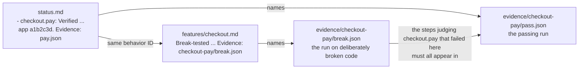

# Harness internals

A verification harness is a folder, kept in an app's code repository, that lets an AI agent prove a code change works on the real running app and lets anyone else check that proof. This reference explains what is in that folder, what each file means, and how the framework's scripts use those files to decide whether a result can be trusted. Use it when you debug a harness, write a tool for one, or change a framework script.

For how to use the skills day to day, see [USAGE](../USAGE.md). For where a given change to the framework belongs, see [Architecture](architecture.md).

## Understand the problem a harness solves

An AI agent that changes code can report "I checked, and it works" when it did not check, when it checked a different version of the code, or when its test could never have failed. A reader cannot tell these apart from a real check by reading the report.

A harness makes the claim checkable. Every test run leaves a saved record behind. A script then compares each "Verified" result against those records and rejects any result the records do not support. A person reading a Verified result can trust it without rerunning anything, because the script already confirmed the records behind it.

## Understand how a behavior earns "Verified"

This example follows one behavior, "paying for an order marks it paid", from no proof to a trusted result. The harness gives each behavior a short name, called its ID. This one is `checkout.pay`.

1. Someone writes a check. A check is a small program that uses the app the way a real user would and then looks at what actually happened. This one submits a payment through the same web address the app's checkout page uses, then reads the order straight from the database to see whether it is marked paid. It does not trust the app's "success" message, because the bug might be in the code that prints that message.
2. Each time the check runs, it saves a record file, called an evidence file. The record lists each step of the run, whether each step passed, and which version of the code the app was running. A version is identified by its Git commit, a short code such as `a1b2c3d` that names one saved snapshot of the code.
3. Before anyone trusts the check, the harness breaks the feature on purpose and runs the check again. This is called a planned break. The break is made in a throwaway copy of the code, for example by deleting the line that saves the payment. The run's record names the behavior the break was aimed at, `checkout.pay`, written before the run so the outcome can't change it. The check must fail on a step that judges that behavior. The record of that failing run is kept. A check that still passes while the feature is broken cannot tell working code from broken code, so its passes mean nothing.
4. The feature's description file in the harness records that the check was tested this way and names the record of the failing run:
   `- checkout.pay: ... Break-tested 2026-10-03: payment save skipped. Evidence: evidence/checkout-pay/break.json`
5. Later, the check runs on the code being verified and passes. The agent writes one line in the harness's results file, `status.md`:
   `- checkout.pay: Verified. ... app a1b2c3d. Evidence: evidence/checkout-pay/pass.json`

Anyone, including an agent, can type the line in step 5. What makes it trustworthy is that the harness's checking script, `validate.py`, refuses it unless all of the following are true:

- The record the line names, `evidence/checkout-pay/pass.json`, exists and shows the check passed. This rules out a pass that never happened.
- That record says it tested `checkout.pay`. This rules out citing a record of some other check.
- That record ran on commit `a1b2c3d`, the version the line names. This rules out a pass on older or different code.
- The feature's description says the check was break-tested, and names the record of that failing run. This rules out a check nobody showed could fail.
- The failing run's record really did fail, was aimed at `checkout.pay`, and failed a step that judges `checkout.pay`. This rules out credit from a break aimed at another behavior, or from a step that failed only because an earlier step did.
- Every step that caught the planned break still appears in the passing run and still judges `checkout.pay`. This rules out a check that was weakened after it was proven, for example by deleting or renaming the step that catches the bug.



Each skill that records results runs `validate.py` right afterward and fixes any line it rejects. A Verified result in a harness that passes `validate.py` has a passing record on the named code and a check that was shown to catch the bug.

## Harness layout

A harness is a folder named `verify-<app>`, such as `verify-shop`. It sits in one of the folders where the project keeps agent skills. A skill is a set of written instructions an AI agent loads to do one kind of job. The harness is itself a small skill, so an agent working on the app can find it.

```text
.agents/skills/verify-shop/     or under .claude/, .pi/, .cursor/
├── README.md                   where a person starts
├── recordings.html             each check's latest run and history, to search and watch
├── SKILL.md                    tells an agent to verify through this harness
├── rules.md                    the shared rules, copied unchanged
├── settings.md                 this app's code locations and commands
├── status.md                   setup notes and latest results
├── tools.md                    guide to every command in scripts/
├── features/
│   ├── README.md               list of the app's features
│   ├── requirements.md         links requirements to checks, if any
│   └── <feature>.md            one per feature users see
├── scripts/
│   ├── framework/              framework copies, never edited
│   │   ├── validate.py
│   │   ├── code_state.py
│   │   ├── break_session.py
│   │   ├── replay.py
│   │   └── clip.py
│   ├── doctor.py               app's own tool, in the app's language
│   ├── probe.py                app's own tool
│   └── check_pay_order.py      app's own check
└── evidence/
    ├── checkout-pay/           one folder per check
    │   ├── 2026-10-03T14-02-11Z.json   record of one run
    │   └── 2026-10-03T14-02-11Z/       that run's video, screenshots, logs, replay page
    ├── doctor/
    │   └── 2026-10-03T13-40-00Z.txt    proof the app could be started
    └── exploration-ledger.jsonl        memory for exploratory testing
```

Times in file names are UTC, written with dashes so they sort in order and read plainly. Each check's runs sit in their own folder so `evidence/` stays browsable as runs pile up.

These locations are fixed in every harness. A team cannot move them through `settings.md`, so any person or skill that knows one harness can find its way around another.

The five framework scripts in `scripts/framework/` are written in Python and are the same in every harness; upgrading them means replacing that folder. The app's own tools, such as the doctor and the checks, are written in whatever language the app uses, so they can reuse its database drivers and settings.

Each file is written and read by specific skills:

| File | Written by | Read by |
| --- | --- | --- |
| `rules.md` | setup-verification, once, as a copy | Every skill |
| `settings.md` | setup-verification, then add-tools or add-feature-checks when it adds a tool the settings name | `validate.py`, `code_state.py`, and every skill |
| `status.md` | setup-verification for setup notes, and verify-change, add-feature-checks, audit-coverage, and verify-pr for results | `validate.py` and every skill, before a run |
| `features/` | add-feature-checks, verify-change when a change alters a behavior, and audit-coverage when a description no longer matches the app | `validate.py`, verify-change, and the audits |
| `tools.md` | setup-verification for the doctor, add-tools and add-feature-checks for every later tool | Agents, including ones debugging without a skill |
| `README.md` | setup-verification, from its template | People opening the harness |
| `recordings.html` | `replay.py`, rewritten after every check run and whenever a clip is cut | People |
| `scripts/framework/` | setup-verification, as copies | Skills and people |
| `scripts/` | setup-verification for the doctor, add-tools and add-feature-checks for the rest | Skills and people |
| `evidence/<check>/<time>.json` | The app's own check programs | `validate.py`, `replay.py`, `clip.py`, and agents diagnosing a failure |
| `evidence/exploration-ledger.jsonl` | `ledger.py` | explore-bugs |

Only `validate.py`, `code_state.py`, `break_session.py`, `replay.py`, and `clip.py` are copied into a harness. The exploration script `ledger.py`, the three audit scripts, and explain-harness's `trust_facts.py` stay with the skill that uses them and are given the harness's folder when they run.

`rules.md` is the authority for every format on this page. It is a copy of [setup-verification's rules](../skills/setup-verification/references/rules.md). If this page and `rules.md` disagree, `rules.md` wins.

## Understand the setup check

Before a harness can verify anything, setup must prove the app can be started and inspected. The doctor is the command that does this. It is a read-only command, meaning it looks without changing anything, and it reports whether the app is running and which version of the code it is running.

Every skill first finds a harness by looking in the project's skill folders for a `verify-*` folder that contains `rules.md`. With one match, the skill uses it. With several, it asks which one. With none, it stops and names setup-verification, the skill that creates a harness.

Every skill that reads a harness then runs the harness's `scripts/framework/validate.py` before doing anything else. The first thing `validate.py` looks at is whether setup finished. It reads two places:

- `settings.md` must contain `- Status: incomplete` or `- Status: ready` under a `## Setup` heading.
- `status.md` must contain exactly one section titled `## Setup: <harness folder name>`, such as `## Setup: verify-shop`. That section has six filled lines: Target (what app is covered), Findings (what setup learned, with sources), Looked in (where it searched), Blocker (what stops setup), Next action (what would let it continue), and Doctor proof (where the doctor's successful output is saved).

A line that still holds a template blank, such as `<app name>`, counts as unfilled. If either file is missing or malformed, `validate.py` exits with code 1, meaning it found a problem. An exit code is the number a program returns when it finishes. These scripts use 0 for "OK", 1 for "found a problem", and 2 for "could not run".

When Status is `incomplete`, the Blocker and Next action lines must say something other than `none`. `validate.py` prints `STOPPED: setup incomplete for <target>`, then the blocker and the next action, and exits with code 2. It checks nothing else, so an unfinished harness gives one clear message instead of a long list of unrelated errors. The skill that ran it reports the blocker and stops.

When Status is `ready`, Doctor proof must point to real output, not `none` or `not run`, and Blocker and Next action must both be `none`. Only then does `validate.py` go on to check the settings and the feature descriptions.

Ready means setup worked once. It does not mean the app is running right now, so every verification run starts by running the doctor again.

## Settings

`settings.md` holds everything specific to one app: where its code lives and which commands start, inspect, and check it. `validate.py` reads it as lines in the form `- <Label>: <value>` under `##` headings, and requires a value for each of these:

- Under `## Workflow`: Requirements source, meaning where the app's written requirements live, or `none`.
- Under `## Commands`: Start (how to start the app), Stop (how to stop what Start started, or `none` when only a person starts the app), Doctor, Ready line (the exact text the doctor prints when the app is ready), Probe (the command that looks up the app's current data), Invariants module (the file of always-true rules), Settle signal (how to tell the app has finished background work), Run scratch code (the command that points the running app at another checkout, `per check` when each check starts the app itself, or `none`), and After an edit (`reloads`, or the command that restarts what runs a repo after a file changes). `break_session.py` fills `{repo}` and `{checkout}` in the last two.
- Under `## Repos`: at least one line naming a code repository and where to find it.

A value counts as unfilled when it still contains a template blank, which `validate.py` spots as `<` followed by a lowercase letter. `status.md` and `tools.md` must also exist.

An app may run code from more than one repository, so `settings.md` lists every one, even when there is only one. Each line is `- <name>: <location>`. The location takes one of two forms:

- A folder path relative to the project root, such as `- app: .` for the app's own code. The project root is the folder holding the skills directory the harness sits in: `app/` for `app/.agents/skills/verify-app/`. In a single-repo app that is the repository's top folder. In a monorepo it is the app's own folder, and a location inside a repository covers only that folder: `dirty` and `dirty_hash` ignore edits to the rest of the repository, while `commit`, `branch`, and `on_main` describe the whole checkout.
- `env:<file>:<KEY>`, which reads the folder path from a settings file the project already has, at the moment a script runs. Each developer's settings file can point to where that repository sits on their own machine. The script opens the file from the project root, uses the last line that starts with `KEY=`, removes surrounding quotes, and expands `~` and environment variables such as `$HOME`.

`validate.py` rejects a full path such as `/Users/sam/code/app` written directly in `settings.md`, because that path works only on one person's machine.

The repository name is how the harness's files refer to that repository. It appears in each evidence file's list of code versions, next to the commit in each Verified line (`app a1b2c3d`), and in warnings about out-of-date results.

## Feature map

The feature map is the `features/` folder. It describes each feature a user can see, splits it into smaller behaviors called sub-features, and says how each sub-feature is proven. A sub-feature is one behavior a user would notice, such as "a returning shopper can pay with a saved card".

Each feature file uses `##` headings. It must have exactly these three, in this order: `Sub-features`, `How a user reaches it`, and `How to prove it`. Three more are optional and can go anywhere: `Request flow`, `Verification plan`, and `Gotchas`. Any other `##` heading is an error, so every feature file has the same shape.

### Sub-feature IDs

Each sub-feature line is `- <id>: <behavior>`, such as `- checkout.saved-card: a returning shopper can pay with a saved card.` An ID uses only lowercase letters, digits, dots, dashes, and underscores, and starts with a letter or digit. No two sub-features anywhere in the map can share an ID.

The ID is what connects a behavior across files. The same ID appears on its proof line in the feature file, in the evidence file of every run that tests it, in its result line in `status.md`, and in any requirement it satisfies.

### Feature list

`features/README.md` lists every feature file under a `## Features` heading, so a reader can find each one from a single page. `validate.py` reports any feature file that is not listed, and any link in the list that points to a file that does not exist.

### Proof lines

Each sub-feature has exactly one line under `How to prove it`. The line says how far the proof has gotten, in one of four forms:

| Proof line | What it means | Can support a Verified result |
| --- | --- | --- |
| `No check yet.` | Nobody has written a check. | No |
| `Unreachable: <blocker>. Tried <route>.` | Someone tried to write a check and something outside the harness stopped them, such as a missing test account. The line must say what was tried. | No |
| `` `<command>`. Not break-tested: <reason>. `` | A check exists, but nobody has shown it can fail. | No |
| `` `<command>`. Break-tested <date>: <what was broken>. Evidence: <file> `` | The check failed on a planned break. The line names the record of that failing run. | Yes |

The command in backticks is how to run the check. If its first word contains a `/`, `validate.py` makes sure that file exists, looking from the project root, not from the harness folder. A command with no `/`, such as `` `make verify` ``, is not checked.

If `validate.py` reports that a command's file does not exist and the file is there, the path is probably written from the harness folder. Write it from the project root, such as `.agents/skills/verify-shop/scripts/check_pay_order.py`.

The evidence file at the end of a `Break-tested` line is different. It is a path from the harness folder, with or without backticks, and `validate.py` checks it only when a Verified result depends on it.

### Requirements map

`features/requirements.md` exists only when the app has a written requirements source, such as a spec document or a launch checklist. It links each requirement to the sub-features that prove it, without copying the requirement itself. Each line is `- <requirement> | <where it is written> | <outcome>`, where the outcome is one of these:

- `ids: <IDs>`, the sub-features that prove it
- `No check yet`
- `not in source`, for a requirement the team knows about that the document leaves out
- `blocked on decision: <decision>`, when nobody has decided the expected behavior
- `out of scope: <reason>`

Every ID listed must exist in the feature map.

## Evidence files

An evidence file is the saved record of one check run. Each run writes a new one, named `evidence/<check>/<time>.json`, such as `evidence/checkout-pay/2026-10-03T14-02-11Z.json`. It is JSON, a common text format for structured data that both people and programs can read.

The app's own check program writes the file. add-feature-checks recommends one shared piece of code for this, called the run recorder, so every check writes the same format. See [the recommended code layout](../skills/add-feature-checks/references/harness-code.md). The framework's scripts only read evidence files. See the [evidence format in rules.md](../skills/setup-verification/references/rules.md#evidence) for a complete example.

Each field, and what depends on it:

- `check`: the check's name, also used for its folder under `evidence/`. The replay page uses it as its title.
- `sub_features`: the IDs of the behaviors this run claims to prove. A Verified result and its planned break must both list the behavior's ID.
- `planned_break`: on a planned break run, what was broken and the IDs it was aimed at, such as `{"what": "payment capture skipped", "sub_features": ["checkout.pay"]}`. The check's run recorder fills it from `VERIFY_PLANNED_BREAK=checkout.pay: payment capture skipped`, set before the run. It is `null` or absent on every other run, and a Verified result can't cite a run that has one. A break proves only the behaviors it was aimed at.
- `passed`: `true` for a pass, `false` for a failure, or `null` when the run only looked around or stopped early. `null` is never a pass. A Verified result needs `true`. Its planned break needs `false`.
- `reads`: whether the check looked only at stored data (`"state"`) or at what the user sees on screen. Proof that the database is right does not prove the screen showed the right thing.
- `code`: for each repository, which code ran. See [Code version](#code-version). A Verified result must name each commit listed here.
- `started_at` and `finished_at`: when the run started and finished, in UTC. `validate.py` uses `finished_at` to find the most recent pass for each behavior.
- `steps`: each step's name, the behaviors its verdict judges (`sub_features`), whether it passed, when its result was decided (`at`), a `detail` such as `status=paid`, and the IDs it looked at. In a check that covers one behavior, a step that lists no behaviors judges that one. In a check that covers several, it judges none, which is right for a setup step. A failed step in a check that uses a browser or app screen also names a `snapshot` taken at that moment.
- `marks`: the run's timeline, used to line up the video. Each mark has a time, a kind (`step` where a numbered step begins, `action` for something a viewer would want to see, such as a click), and a label.
- `recording`: the video's path inside `evidence/`, and `starts_at`, when the video began.
- `created`: the IDs of things the run created, such as test orders. Cleanup deletes only these, so it never removes data the run did not make.
- `stopped`: why the run stopped early, or `null`.

### Time

Every time in an evidence file is a number of seconds since the run started. A step's `at` is the moment its pass or fail was decided, not when the step began. A `step` mark records when a numbered step began.

To find a moment in the video, subtract `recording.starts_at` from its time. A negative result means it happened before the video started.

### Code version

The `code` field has one entry per repository, with five values:

- `commit`: the full ID of the commit.
- `branch`: the branch that was checked out, or `null` when no branch was, such as when a specific commit was checked out directly.
- `dirty`: `true` when the repository had changes not yet saved as a commit. That means a file that was edited, staged for a commit, or newly added, outside the harness folder and, when the repository's location names a folder inside it, within that folder. Files Git is told to ignore do not count. The harness folder is excluded so the evidence files a run writes do not make the next run look dirty.
- `dirty_hash`: a fingerprint of the uncommitted code, or `null` when clean. It is the SHA-256 of staged and unstaged binary diffs and of untracked file names, modes, and contents. Ignored files and this harness are excluded, including in a scratch worktree. Any change to those diffs or untracked contents changes the fingerprint, and the fingerprint does not expose source content in evidence.
- `on_main`: whether the commit is already part of the repository's main branch. The main branch is the one the remote copy marks as its default when that is known, otherwise a local `main`, otherwise `master`. It is `null` when none of these exists.

Every tool that records these values gets them from `scripts/framework/code_state.py` instead of asking Git itself, so every tool means the same thing by each value. Run it from the harness folder:

```sh
python3 scripts/framework/code_state.py
```

It prints one JSON object keyed by repository name, ready to copy into an evidence file's `code` field. `--checkout app=<folder>` reports one repository from another folder instead of its usual one. While a planned break session is open on a repository, ordinary code recording refuses, even with `--checkout`. The guard checks both the configured repository and an override's repository. Only the owning harness may report the scratch copy, with `VERIFY_PLANNED_BREAK` set, and any override must name that copy. A different harness must wait for the owner to end the session.

It exits with 2, with a `STOPPED:` line explaining why, when:

- `settings.md` lists no repositories, or has a repository line `validate.py` would reject.
- `--checkout` names a repository `settings.md` does not list.
- A repository's folder cannot be found.
- A repository has no commits.
- A session guard refuses the run.

`code_state.py` reports what is in the folder. That can differ from what the running app loaded, because an app keeps running the code it started with until it restarts, even if someone edits the files afterward. The doctor is responsible for knowing which code is actually running. For example, it can save `code_state.py`'s output when the app starts and compare the commit and `dirty_hash` with a fresh run later. Two dirty checkouts at the same commit are not the same code unless their fingerprints match. A health page that asks Git for the current commit every time it is called does not establish this, because it reports what is in the folder, not what is running.

### Write order

The check prints each step's pass or fail as soon as it is decided, so a crash later in the run cannot hide an earlier result. It writes the evidence file before any cleanup runs. It first writes a temporary file and then renames it into place, so a reader never sees a half-written file.

A step keeps the same name and the same `sub_features` on every run, because `validate.py` compares a planned break's steps with a later pass's steps by name. Values that change from run to run, such as an order ID, go in `detail`.

### Run folder

When a run keeps files beyond its record, they go in a folder beside the evidence file, with the same name minus `.json`. It can hold:

- The video of the run
- Screenshots and page text taken when a step failed, such as `step-3-failed.png` and `step-3-failed.txt`
- `console.json` and `requests.json`: the browser's error messages and its failed network requests, each with the time it happened
- `replay.html`, made later by `replay.py`
- Video clips and still frames, made later by `clip.py`
- `break.patch`, on a planned break run: the exact edit the break made, saved by `break_session.py`

A check that uses a screen keeps its video only when the run fails or its environment sets `VERIFY_KEEP_RECORDING=1`, because videos are large. A person or agent sets that variable to ask for a passing run's video.

## Understand every rule validate.py applies to a Verified result

A result line in `status.md` under `## Latest results` starts with the sub-feature ID and one of three verdicts: `Verified`, `Failed`, or `Not verified`. The last line for each behavior is authoritative, regardless of evidence timestamps. Replace earlier lines when recording a result and keep historical runs outside this section. Only current Verified lines are checked against evidence. Failed and Not verified lines are plain text after the verdict, and supersede earlier passes even without an evidence file.

For each Verified line, `validate.py` reports an error when:

1. The feature file has no check for that ID, or the check's proof line does not say `Break-tested`.
2. The line names no evidence file, or the file is not valid JSON.
3. The named run did not pass, does not list the ID, has no step that judges the ID, is a planned break run, or does not record which code it ran.
4. The line does not name each repository from the run's record together with its commit, such as `app a1b2c3d`. The line may shorten the commit to as few as seven characters.
5. A step in the run has no time, or its time is not zero or more.
6. The run names a video outside `evidence/`, or does not say when the video started.
7. The planned break's record did not fail, stopped early, names a different check, records no `planned_break`, was aimed at other behaviors, or failed no step that judges the ID.
8. A step that judges the ID and failed during the planned break is missing from the passing run, or no longer judges the ID there.
9. The passing record stopped, has no steps, or includes a step that did not pass. Either record has malformed or duplicate step names, non-boolean step verdicts, a missing check name, malformed sub-feature IDs or code versions, a step or `planned_break` naming a behavior the run doesn't list, or a `planned_break` that doesn't say what was broken.
10. Either record omits a repository listed in settings, records dirty code without a valid `dirty_hash`, or attaches a hash to clean code.

A planned break proves a behavior only when it was aimed at that behavior, and only through the steps judging that behavior that failed during it, because those are the steps that caught the bug. In a checkout check covering payment and the receipt, a break that skips payment also fails the receipt step, since there is no paid order to send a receipt for. That proves the payment step can catch a bug, and nothing about the receipt step. Adding a new step later makes the check stricter, so it needs no new planned break. Renaming or removing a step that caught the break, or changing which behaviors it judges, means the planned break must be run again. See [ADR 0006](adr/0006-back-every-verified-with-its-evidence.md) and [ADR 0017](adr/0017-credit-a-planned-break-only-to-what-it-broke.md), the decision records behind this rule.

For example, if the step `order is paid` caught the planned break and was later renamed, `validate.py` prints:

```text
ERROR status.md: orders.pay is Verified, but step 'order is paid' caught its planned break and does not judge it in this run
1 features, 1 sub-features, 1 with checks, 1 errors
```

A team may choose not to keep evidence files in Git, so a fresh copy of the repository may not have them. When a named file is missing, whether a run record, a planned break record, or a video, `validate.py` prints a warning instead of an error. With `--require-evidence`, a missing file is an error. Skills use `--require-evidence` right after recording results, when the files must exist.

### Out-of-date warnings

`validate.py` also warns when results are getting old, separately from the rules above. It looks through every evidence file, finds the most recent passing run for each behavior that has a check, and compares it with the current code in each repository. It warns when:

- A behavior has no passing run at all.
- A repository's folder cannot be found from `settings.md`.
- The commit the run tested is not in the repository.
- The commit the run tested is behind the current commit, with how many commits behind.
- The run tested code that had unsaved changes.

It also lists up to three files that have unsaved changes in each repository right now. Warnings start with `WARN` and do not change the exit code.

### Limits

`validate.py` cannot tell when the code inside a step changed while the step's name stayed the same. In that case, the agent must run the planned break again on its own judgment.

`validate.py` cannot tell whether a check really uses the app the way a user would, or whether it reads results without going through the app's own code. Other safeguards cover that. A separate agent reviews each new check against the agreed plan before its first run, without seeing the author's reasoning. The audit-coverage and audit-weak-checks skills review checks again later.

## Prove a check with a planned break

add-feature-checks runs these steps to give a check its `Break-tested` line:

1. Run the check on the current code. It should pass. If it fails, find out whether the app or the check is wrong before going further.
2. Tell the user `Planned break: <the change>`. The change is the smallest one that makes one behavior wrong while the app still builds, such as skipping the line that saves a payment.
3. Run `scripts/framework/break_session.py start <repository>`. It makes a throwaway copy of the repository with `git worktree add`, a second, separate folder of the same repository, at the commit under test, and copies in the developer's staged, unstaged, and new files. It confirms the copy's `dirty_hash` matches the developer's folder, then points the app at the copy with the `Run scratch code` setting.
4. Make the change in the copy without committing it, then run `break_session.py run <repository> "<behavior ID>: <the change>" -- <check command>`. It confirms the developer's folder hasn't changed and the copy holds an edit, runs `After an edit` unless the app reloads by itself, and runs the check with `VERIFY_PLANNED_BREAK` set. It saves the edit as `break.patch` in the folder of the record the check wrote, then puts the copy back and confirms its fingerprint, whatever the check did. The record must show that repository with unsaved changes, and the run must fail on a step that judges the broken behavior.
5. Run `break_session.py end <repository>`. It points the app back at the developer's folder, removes the copy, and reports any change to the developer's folder since the session started.
6. Write `Break-tested <date>: <what was broken>. Evidence: <the failing run's record>` on the broken behavior's proof line.

The session lives in `verify-break-session/` inside the repository's shared Git folder, which every worktree of it can see and Git never commits. It holds the developer's saved changes and `session.json`, which names the owning harness by its absolute folder path, the copy, the starting commit and fingerprint, and the intended app checkout. One session covers the whole Git repository, so another harness in that repository cannot start, run, end, or record code through it. Its status command shows the owner instead.

Commands the script runs from `settings.md` set `VERIFY_BREAK_SESSION` to the session's repository name, so their own `code_state.py` calls report the folder the app is being pointed at. The commands must confirm the loaded version through the doctor. Restoring scratch files does not reload running processes or undo data changes.

`end` marks the session as ending before it points the app back, so a crash at any point leaves a session that blocks ordinary runs, and running `end` again finishes it. `break_session.py status` shows each repository's session and whether its copy holds an edit. `break_session.py replay <repository> <record> -- <check command>` applies a saved `break.patch` and runs it again, for re-proving a check after a step changes.

`break_session.py` exits 0 when the step finished, whatever the check's own result; 1 when a guard found a problem, such as a session already open, no edit to run, the developer's folder changing, or no planned break record written; and 2 when it could not run, with a `STOPPED:` line.

Keep the failing run's record in `evidence/`, because every later Verified result for that behavior is checked against it.

Two kinds of check get a `Not break-tested` line instead:

- A check for behavior the team wants but has not built yet. It fails on today's code and names the ticket tracking the work.
- A check for an existing bug. Instead of failing on a planned break, it is shown to pass on a planned fix, a small throwaway change that repairs the bug.

Neither can support a Verified result until it passes on the real code and then fails on a planned break.

## Tool contracts

The app's own tools are ordinary command-line programs in the app's language. The framework does not dictate how they are written. It does fix how they behave, so skills and people can rely on them the same way in every harness. See `rules.md` for every rule. The parts other tools depend on are:

- Doctor: reports whether the app is ready to test, and changes nothing. It exits with 0 when ready, 1 when not ready with one reason per line, and 2 when it cannot tell. When ready, it prints the exact Ready line from `settings.md`, which other tools may look for.
- Probe: answers one question about the app's current data, such as `probe order o_123`. It changes nothing: database reads cannot write, and web requests only fetch. It prints its answer as one JSON object, or the complete raw data with `--full`. It exits with 0 when it answered, 1 when the thing does not exist (printing `{"not_found": ..., "hint": ...}`), and 2 when it could not answer (printing `STOPPED: <reason>` as an error). Its answer can include `next`, follow-up probe commands worth running, and `problems`, any always-true rules the data breaks.
- Invariant: a rule that must always hold no matter what happened, such as "a paid order has exactly one payment". Each is a function in the file `settings.md` names. It is given data that was already read, does not read anything itself, does not use the app's code, and returns a list of violations. Each violation has the rule's name, a kind, and a detail. The kind is `safety` (must hold at every moment), `eventual` (must hold once background work finishes), or `lead` (worth a look, but not necessarily wrong). A value that could not be read is not judged. A value that was read and found missing is.
- Action: does something a real user or operator would do, through the same button or web address they use. An action that affects anything outside this machine, or anything shared, refuses to run unless it is given `--user-approved`, which an agent passes only when the user approved that action. It also refuses to touch things the harness did not create, except a record the user named for this run, passed by its ID along with `--user-approved`. It prints one JSON object naming the action, what it acted on, and the IDs of anything it created. It exits with 0 on success and 2 when it refused or failed.
- Check: uses the app the way a user would, reads back every result by its exact ID, and writes one evidence file. It exits with 0 when it passed, 1 when a step failed, and 2 when it stopped or could not run.

Checks and probes never judge a result by asking the app's own code, because a bug in that code could then make a broken feature look fine. They read the database row, the raw web response, or the screen directly.

A check and a probe that need the same fact use the same piece of code to read it, so a probe can always re-check what a check concluded.

A probe may read the app's own API, but the API's answer is still built by the app's code. Such a probe says so in its Limits line, and a check that judges what that endpoint does reads the database or the outside system instead.

### Tool guide checks

`validate.py` reads every `##` entry in `tools.md` and fails one that lacks any of these lines:

- `Use when:`
- `- Inputs:`, `- Environment:`, `- Permissions:`, `- Result:`, `- Failure:`, and `- Limits:`
- `Run from <folder>:`, naming `the project root`, `.`, or a folder that exists under it
- ``Help: `<command> --help` ``

When the Help command names a file (any word with a `/`), that file must exist in the Run from folder. With `--run-help` it also runs each Help command from that folder, which must exit 0 within 10 seconds. add-tools and add-feature-checks pass it after publishing a tool. It is off by default because every skill runs `validate.py` first, and running every tool would slow each one.

`validate.py` also fails any line in `tools.md` or `scripts/`, outside `scripts/framework/`, that looks like a credential: a bearer token, a quoted cookie, a quoted value of 16 or more characters with a digit assigned to a key, token, secret, or password name, or a known AWS, GitHub, Slack, or private-key format. It names the file and line, never the value. A value containing `$`, `<`, or `{` is treated as a lookup or a template blank, so reading from the environment passes.

## Replay pages and clips

`replay.py` and `clip.py` turn a run's evidence file and video into things people and agents can look at. They read only those files and never contact the app, so the same copy works in every harness whatever language the app uses.

### Replay page

A replay page is a web page for watching what happened in one run. Run:

```sh
scripts/framework/replay.py evidence/checkout-pay/2026-10-03T14-02-11Z.json
```

`replay.py` combines the run's marks and steps into one timeline, in time order. It saves the page as `replay.html` in the run's folder, or wherever `--out` says.

Generated pages use a separate temporary file for each writer, in the destination folder, then atomically replace the destination. Overlapping commands can publish complete pages without sharing a temporary file. A failed publication removes its temporary file and leaves the destination unchanged.

The page needs no internet connection, because everything it shows is built into the file. The video stays on the left and the run's steps are listed on the right, grouped under the run's `step` marks, with each group's failures counted. Groups holding a failure start open; the rest start collapsed.

Clicking a step plays the video from that moment, or from 3 seconds before a failure, and shows the step under the video: its detail and evidence, plus the screenshot and a link to the page's text when it failed. Red marks on a strip under the video show where each failure happened. `j` or the down arrow jumps to the next failure, and `k` or the up arrow to the previous one. As the video plays, the list highlights the current step, and a caption under the video names the current step mark. For 3 seconds after a failure, the caption turns into a `Problem:` message.

The page opens on the first failure, ready to play from just before it, or on the moment a `#at=<seconds>` link names. A run with no video gets the same page without the video.

`replay.py` exits with 2 when it cannot read the evidence file. It warns when the evidence file names a video that is not there.

### Recordings page

`recordings.html`, at the harness's top level, is how a person sees how the checks are doing without knowing a run's file name. Setup creates it with `replay.py --recordings`, so it exists before any check runs, and the feature map links to it.

A page opened from disk can't list a folder's files, so the page is rewritten instead. Every check run runs `replay.py` right after writing its evidence, and one that kept its video prints the page's path. `replay.py` and `clip.py` rebuild it every time they write a replay page or cut a clip. verify-change's report links it.

It builds the replay page of any run that lacks one, and rebuilds one built in an older page format: each replay page carries the format it was built in, and `replay.py` raises that number whenever new pages gain something old ones lack. A run's evidence never changes, so a rebuild only updates the page.

Only a folder holding `rules.md` counts as a harness. Given evidence anywhere else, `replay.py` writes the replay page alone and no recordings page, and `--recordings` on such a folder stops with exit code 2.

The page shows the least a developer needs first and opens the rest on request.

At the top is the app's name, from the harness folder's name without `verify-`, under a "Verification framework" label.

Below that is one line per check for its latest run. Failing checks come first, then ones that didn't finish, then passing ones, each group most recent first. A check is titled with the feature it belongs to, the feature file whose "How to prove it" lines name the check most often, with the check's own name beside it. Under the title, the first sentence of that feature file's opening paragraph says what the check tests. The line gives:

- The result: Failed, Didn't finish, or Passed.
- The first failed step's name, the stop reason, or how many steps passed.
- How many steps failed or, for a run that didn't finish, that it has no verdict and how many steps had failed before it stopped.
- When the run started, in the reader's time zone, with how long ago. "Earlier code" names the repos whose code differs from the newest run's.
- When the run kept a video, one button that opens its replay page a few seconds before the first failure or before where it stopped.

Details under each check show:

- Every failed step with its detail and a link to its moment in the video.
- The full stop reason.
- The behaviors the run judged, by their plain wording from `features/`, with failed ones listed and passed or unjudged ones collapsed. When no step names the behaviors it judges, it lists the behaviors the check covers instead.
- One aligned line per repo with its branch and commit, marked "local edits" for uncommitted changes and "not on main" for a commit off the main branch.
- The check's ten earlier runs with their results.
- The replay page and any clips.

Planned breaks are left out because they fail on purpose. A footnote counts them and points to the feature map, whose proof lines link each one.

Filter buttons cover all checks and each result some check has. A search box keeps checks containing every typed word, matched against check, feature, behaviors, step names, and every run's time, result, repos, branches, and commits. `/` jumps to the search box and Escape clears it. The search and filters stay at the top while the page scrolls.

The replay page links back to the recordings page and to the raw video file. Opened with `#at=<seconds>`, it starts the video there. Both pages follow the computer's light or dark setting and need no internet connection. Evidence files it cannot read are left out, and `validate.py` reports those.

### Clips and still frames

`clip.py` cuts a run's video by step. Step 1 runs from its `step` mark to the next `step` mark, and so on. The last step runs to the end of the video.

- `clip.py <evidence file>` lists each step's number, time range, and label.
- `clip.py <evidence file> --steps 2-3` makes a short MP4 video of steps 2 and 3, starting half a second before step 2, for attaching to a pull request. Its name says what it shows on its own: the check, the steps, the first step's label without its `Step N:` prefix, and when the run started, such as `checkout-pay-steps-2-to-3-customer-pays-2026-10-03-1402.mp4`.
- `clip.py <evidence file> --frames failed` saves three still images per failed step: 3 seconds before the failure, at it, and 1 second after.
- `clip.py <evidence file> --frames 2` saves four still images spread across step 2. For the last step, it assumes the step lasted 10 seconds, because the evidence does not record the video's length.
- `clip.py --check` reports whether this computer can make still images, clips, and captions, and prints how to install anything missing. It exits with 1 when something is missing.

A clip has a caption bar under the video. Each mark's label shows until the next mark, or for 30 seconds after the last one. Each failed step adds a red `Problem:` caption for 3 seconds. The captions sit under the recorded page, not on top of it, so they never hide what happened.

To draw captions, `clip.py` uses Chrome, Chromium, or Edge without opening a window. It looks for one in this order: the `CHROME` environment variable, the headless-only build the Playwright testing tool downloads, the command path, the usual install locations, then Playwright's full browsers. The headless-only build comes first because on macOS a full browser can abort at launch in a shell where it may not register as a windowed app, such as an agent's sandboxed shell. Without a browser, it uses ffmpeg's subtitle feature. With neither, a clip can still be made with `--no-captions`.

Clips are compressed so a minute of screen video stays a few megabytes, in a format GitHub, chat tools, and browsers play without a download. Making clips and still images needs ffmpeg, a common video tool, with its companion ffprobe. Replay pages, screenshots, and logs need neither.

Agents never install these tools themselves. They show the install command from `clip.py --check` instead.

### Diagnose a failed step

An agent works out why a step failed from its `detail`, the page text saved when it failed, and the browser's errors and failed requests from the few seconds before. If those do not explain it, the agent looks at the still images from `--frames failed`. Agents do not watch the video, because most cannot, and a few images plus the page's text tell them more for less effort.

## Exploration ledger

The explore-bugs skill looks for bugs nobody has written a check for. Each time it runs, it does one round: it picks one kind of change, such as clicking twice quickly or entering a very long name, and tries it in several new ways on the real app. A sweep is a series of rounds over one period, named by its date.

Each round starts in a fresh session with no memory of earlier rounds. The ledger, `evidence/exploration-ledger.jsonl`, is how the next round knows what was already tried. The skill reads a summary of the ledger at the start of each round and adds the round to it at the end. The ledger is managed by `ledger.py`, which lives in explore-bugs' `scripts/` folder and refuses to work on a folder with no `rules.md`.

The ledger is a JSON Lines file, meaning one JSON record per line. Lines are only ever added, never changed. There are four kinds of line:

```json
{"round": 4, "at": "2026-10-16T20:30:00", "created": ["o_1"]}
{"round": 4, "at": "2026-10-16T20:34:13", "sweep": "2026-10-16", "hypothesis": "pay clicked twice in a row charges once", "kind": "timing", "command": "scripts/explore pay-twice", "signature": ["invariant:one-payment"], "verdict": "no-break"}
{"at": "2026-10-16T20:41:02", "cleaned": ["o_1"]}
{"at": "2026-10-18T09:12:40", "closed": [2]}
```

### Round lines

`ledger.py --harness <folder> add '<json>'` adds a round. The record needs these fields:

- `sweep`: the sweep's date
- `hypothesis`: the cases tried, such as "pay clicked twice in a row charges once"
- `kind`: the kind of change tried
- `command`: the command that ran the round
- `signature`: what the round ran into, described below
- `verdict`: what the round concluded

It can also have `reproduced` (how many reruns showed the same bug), `evidence` (the evidence file), and `finding` (the bug found).

`add` rejects a record when:

- `kind` is not `timing`, `order`, `identity`, `input-shape`, `lifecycle`, `external-side`, `code-reading`, or `planted`.
- `verdict` is not `finding` (a confirmed bug), `known` (a bug already on record), `no-break` (nothing broke), `lead` (something odd that has not been confirmed), `invalid` (the test setup caused the result), `planted-caught`, or `planted-missed`.
- It is not a JSON object.
- `signature` is not a list of text values.
- `kind` is `planted` but `verdict` is not `planted-caught` or `planted-missed`, or the other way around.
- The record includes `round`, `at`, `created`, `cleaned`, or `closed`, which only `ledger.py` writes.

`add` numbers the round itself, one more than the rounds already recorded, and stamps it with the current local time. Run `ledger.py add --help` to see every field and verdict.

A signature lists what a round ran into: each failed check, each broken always-true rule, and each kind of unexpected error, as short labels such as `invariant:one-live-session` or `log:timeout-calling-billing`. A round discovers something new only when at least one failure or anomaly label has not appeared in any earlier non-calibration round. Combining known labels does not count as new, and an empty signature never counts as new. This measures failure discoveries, not successful coverage.

### History search

`ledger.py --harness <folder> history [query]` prints every completed round as a JSON list, optionally filtered by a case-insensitive substring in any field. It includes rounds older than the summary's five recent entries. Resource, cleanup, and close events are not rounds.

### Resource lines

`ledger.py --harness <folder> created <id> ...` records resources immediately after creation, before the round is complete. It assigns the next round number without counting the event as a completed round. `summary.to_clean` includes these IDs, so the next session sees them even if this one ends before `add`. The `add` that completes the round uses the same number.

### Cleanup lines

`ledger.py --harness <folder> cleaned <id> ...` records test data a round created and has since deleted. A cleanup line holds only the time and the deleted IDs.

### Close lines

`ledger.py --harness <folder> close <round> ...` marks a bug or lead as resolved. Close a bug once its check passes on the current code, meaning it was fixed. Close a lead once a later round confirmed it as a bug, matched it to a bug already on record, or ruled it out. A close line holds only the time and the round numbers.

`close` exits with 2 and writes nothing when a round is not an open bug or lead, including one that is already closed.

### Summary

`ledger.py --harness <folder> summary` prints where the loop stands, as JSON:

- `rounds`: how many rounds have run.
- `sweep`: the latest round's sweep date.
- `rounds_since_new_signature`: how many rounds have passed since one found an individual failure or anomaly label no earlier round had. Calibration rounds, described below, are not counted.
- `must_change_approach`: `true` once 3 rounds in a row found nothing new. The skill then stops trying variations and instead reads recent code changes to find untested paths.
- `kinds_tried`: how many rounds have tried each kind of change. The skill picks the kinds tried least.
- `planted_caught`: how many calibration rounds found their planted bug, out of how many ran, such as `2/3`.
- `open_findings`: bugs and leads that have not been closed.
- `to_clean`: IDs from resource events, applied in event order with cleanup records, including unfinished rounds. Recreating an ID after its cleanup makes it open again.
- `recent`: the last five rounds' kind, cases, verdict, and signature.

A calibration round tests the loop itself. A separate agent plants a known bug in a throwaway copy of the code without saying which, and the round has to find it. Its kind is `planted`, and its verdict is `planted-caught` or `planted-missed`. Calibration rounds are left out of the "anything new" count because they find a known bug on purpose.

## Trust facts script

explain-harness runs `trust_facts.py` to gather what the harness records about each behavior, so the agent answers from fields rather than rereading every file. It loads the harness's own `scripts/framework/validate.py` and uses its parser, so it reads whatever format that harness's `validate.py` accepts. It judges nothing. `validate.py` still reports format errors and stale results.

It prints one JSON object with one entry per behavior, in feature-map order. Each entry includes the behavior line, its verification plan line, and its proof line split into the command, what it reads, and the planned break or the reason there is none.

It also includes the behavior's last result line in Latest results, regardless of the run's timestamp or absent evidence, with each repo's commit and uncommitted-content fingerprint, its uncommitted files, and how many commits that is behind the checkout's HEAD.

A break counts as having caught a problem for a behavior only when its evidence file is in the checkout, failed, was aimed at that behavior, and failed at least one step that judges it.

Lines under `status.md`'s "Where a pass can mislead" that start with a behavior's ID attach to it as caveats. The rest, with the untested and known-failing lists, stay at the top level. A `tally` counts the behaviors in each state. `--help` lists every field.

`--html <path>` writes the same facts as one self-contained page instead. It leaves out whether a check acts like a user and reads the result itself, since only the check's code answers that. The script exits 0 with its output, and 2 when the harness has no `scripts/framework/validate.py` or no feature index.

## Locate script

verification-framework runs `locate.py` before picking a playbook. It prints one JSON object with three fields:

- `skills` maps each framework skill to its `SKILL.md` path, or null when it isn't installed anywhere the script looks.
- `missing` lists the nulls.
- `harnesses` lists each folder matching `verify-*/rules.md` in the skills directories of the current folder and of each folder above it up to the Git top level, nearest first, counted once when a symlink reaches it twice. Searching upward finds a monorepo app's harness in the app's own folder.

It looks for each skill beside its own folder first, then beside the folder a symlink points to, then in those project skills directories, then in the same directories under the home directory. It exits 0 when every skill is found, 1 when any is missing, and 2 when `--repo` isn't a directory. Its tests fail when a skill folder is added or renamed without updating its list and the playbooks.

## Audit scripts

The audit-weak-checks skill looks for checks that would keep passing even if the behavior they guard broke. It provides three scripts for harnesses whose checks are written in Python. They run from that skill's `scripts/` folder against any harness, including one this framework did not build. For other languages, the skill follows the same steps by hand.

### break_checks.py

`break_checks.py` finds rule-checking functions that the project's unit tests would not notice if they stopped working. A unit test is a small automated test of one piece of code, run without the real app.

It looks for functions whose names suggest they check rules: by default, names ending in `_problems` or `_violations`, or starting with `check_`. Change this with `--match`. For each one, it works out what "nothing is wrong" looks like for that function, such as an empty list, from how the function is declared or what it returns.

For each function, it copies the project into a temporary folder and makes that function always return "nothing is wrong". Then it runs the unit tests. Each function gets one of three results:

- `CAUGHT`: a unit test failed, so the tests would notice if this check stopped working.
- `SURVIVED`: every unit test still passed, so the tests cannot tell this check from one that does nothing.
- `SKIPPED`: the script could not work out what "nothing is wrong" looks like for it.

The tests must pass in an unchanged temporary copy first. If they fail there, `break_checks.py` exits with 2, usually because the copy is missing a file the tests need. Add that file's folder with `--copy`. The script exits with 1 when any check survived.

By default it looks in a folder named `harness` (change this with `--harness`), allows each test run 600 seconds, and runs half as many copies at once as the computer has processor cores, with a minimum of 2.

### smells.py

`smells.py` lists test code shaped like a test that cannot fail. In test files, it flags tests with no checks at all (`no-assert`), tests that only check that something came back (`only-exists`), checks that compare a value with itself (`self-compare`), and tests that are switched off (`skip`). In other harness files, it flags error handling that swallows every error without reporting it (`swallow`).

Each item is something for an agent to read and judge, not a verdict. The script exits with 1 when it lists anything.

### weakened.py

`weakened.py` lists ways the tests and checks got weaker since a starting point. It reports deleted tests, files that lost more checks than they gained, each removed check, newly switched-off tests, and rule-checking functions whose code or decorators changed. A changed file that no longer parses is listed too, to read by hand.

The starting point is the last commit whose title starts with `Audit harness checks`. If there is none, it is the newest commit older than 30 days, and with neither the script stops and asks for `--since`. audit-weak-checks offers to save its fixes in a commit with that title, so the next audit starts where this one ended. Pass `--since <commit>` to choose a different starting point. The script exits with 1 when it lists anything.

## Script conventions

The framework's scripts all follow these rules:

- Exit code 0 means OK, 1 means it found a problem, and 2 means it could not run. `validate.py`, `code_state.py`, `ledger.py`, `locate.py`, `replay.py`, `clip.py`, `weakened.py`, and `smells.py` explain a 2 on a line that starts with `STOPPED:`, and so does `break_checks.py` when a file cannot be parsed.
- `validate.py` prints one line per problem, starting with `ERROR` or `WARN`, then a summary line with how many features, sub-features, checks, and errors it found. `code_state.py`, `ledger.py`, and `locate.py` print JSON. The audit scripts print one item per line.
- They use only what comes with Python 3, so they run on a fresh computer without installing anything. ffmpeg and a Chrome-family browser are optional, and only `clip.py` uses them.
- Each script has its unit tests beside it, in `test_<script>.py`. Run a skill's tests with `python3 -m unittest discover -s skills/<name>/scripts`.
