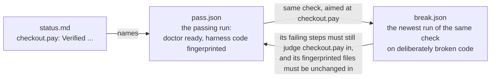

# Harness internals

A verification harness is a folder in an app's repository that lets an AI agent prove a code change works on the real running app, and lets anyone else check that proof. Use this page when you debug a harness, write a tool for one, or change a framework script.

For day-to-day use, see [USAGE](../USAGE.md). For where a change to the framework belongs, see [Architecture](architecture.md). `rules.md`, a copy of [vf's rules](../skills/vf/references/rules.md), is the authority for every format here. If the two disagree, `rules.md` wins.

**Contents:** [How a behavior earns Verified](#how-a-behavior-earns-verified) · [Harness layout](#harness-layout) · [The setup gate](#the-setup-gate) · [Manifest](#manifest) · [Feature map](#feature-map) · [Evidence files](#evidence-files) · [Result lines](#how-the-result-lines-are-written) · [Planned breaks](#prove-a-check-with-a-planned-break) · [Launch helper](#launch-helper) · [Tool contracts](#tool-contracts) · [Replay pages and clips](#replay-pages-and-clips) · [Other scripts](#other-scripts)

## The problem a harness solves

An agent that changes code can report "I checked, and it works" when it didn't check, checked a different version, or ran a test that could never have failed. A reader can't tell these apart from a real check.

A harness makes the claim checkable. Every run leaves a record. A script compares each Verified result against those records and rejects any the records don't support, so a reader can trust a Verified result without rerunning anything.

## How a behavior earns Verified

Follow one behavior, "paying for an order marks it paid", with the ID `checkout.pay`.

1. **Someone writes a check.** It submits a payment through the same address the checkout page uses, then reads the order straight from the database. It doesn't rely on the app's "success" message, because the bug might be in the code that prints it.
2. **Each run leaves an evidence file.** It lists each step, whether it passed, and which commit the app was running.
3. **The harness breaks the feature on purpose** in a throwaway copy of the code, for example by deleting the line that saves the payment, and runs the check again. This is a planned break. The record names the behavior it was aimed at before the run, and the check must fail on a step that judges that behavior. The record is kept.
4. **The break's record fingerprints the harness's own code**: a hash of every file under the harness's `scripts/` (apart from the framework's copies) plus any file the check command names.
5. **Later the check passes on the code being verified.** `vf.py run` ran the doctor first, so the record shows the app was ready, and it fingerprints the harness code again. `vf.py status` writes one line in `status.md`:

   ```text
   - checkout.pay: Verified. checkout-pay, reads state, app a1b2c3d. Break-tested 2026-10-03: payment save skipped. Evidence: evidence/checkout-pay/pass.json
   ```

`vf.py status` writes that line, not an agent. It computes it from the records, every accepted run refreshes it, and `validate.py` refuses a Verified line that `status` wouldn't write now. The line stands only while all of these hold:

| Condition | What it rules out |
| --- | --- |
| The named record exists and shows a pass | A pass that never happened |
| The record says it tested `checkout.pay` | Citing a record of some other check |
| The record ran on the commit the line names | A pass on older or different code |
| The doctor reported the app ready before the check ran | A pass against a half-started app or one running other code |
| The newest planned break of this check aimed at `checkout.pay` failed, on a step that judges `checkout.pay`, and every step that failed before it judges one of the break's targets | A check nobody showed could fail, or credit from a step that failed only because an earlier one did |
| Every step that caught the break still appears in the passing run and still judges `checkout.pay` | A check weakened after it was proven |
| Every harness file the break fingerprinted has the same fingerprint in the passing run | A check edited after it was proven |
| Nobody has since recorded, with `vf.py not-verified`, that the result can't be trusted | A pass kept after the agent found a reason not to trust it |



## Harness layout

A harness is a folder named `verify-<app>` in one of the folders where the project keeps agent skills. It is itself a small skill, so an agent working on the app can find it.

```text
.agents/skills/verify-shop/     or under .claude/, .pi/, .cursor/
├── README.md                   where a person starts
├── recordings.html             each check's latest run and history
├── SKILL.md                    tells an agent to verify through this harness
├── rules.md                    the shared rules, copied unchanged
├── harness.json                the manifest: setup status, repos, commands, tool entries
├── status.md                   the latest results, written by vf.py status
├── notes.md                    setup notes and caveats, written by people and agents
├── tools.md                    guide to every command, written by vf.py tools
├── features/
│   └── <feature>.json          one per feature users see
├── scripts/
│   ├── framework/              framework copies, never edited
│   │   ├── vf.py  validate.py  code_state.py  break_session.py
│   │   ├── launch.py  replay.py  clip.py  trust_facts.py
│   │   └── framework.sha256    hash of each framework file as copied
│   ├── doctor.py               app's own tool, in the app's language
│   └── check_pay_order.py      app's own check
└── evidence/
    ├── checkout-pay/           one folder per check
    │   ├── 2026-10-03T14-02-11Z.json   record of one run
    │   ├── 2026-10-03T14-02-11Z.patch  on a planned break, the edit it made
    │   └── 2026-10-03T14-02-11Z/       that run's video, screenshots, logs, replay page
    ├── doctor/                 proof the app could be started
    ├── launch/                 the record of an instance vf.py start started
    ├── breaks.jsonl            one line per behavior a planned break caught
    └── not-verified.jsonl      reasons agents recorded for not trusting a result
```

Times in file names are UTC, with dashes so they sort in order. These locations are fixed in every harness; the manifest can't move them.

Beside the harness, the same skills directory holds `vf/`: a copy of the framework skill without its `scripts/`, so a clone of the repo needs no install. `sync` writes it, records its hashes in `framework.sha256` under paths such as `../vf/SKILL.md`, and writes the same copy into every other known skills directory at the project root.

The eight framework scripts are Python and identical in every harness, so a clone of the repo holds everything a run, a verdict, or a replay needs. Call the run and record scripts through `vf.py`: `validate`, `code-state`, `break`, `replay`, and `clip` run the script of that name; `start`, `stop`, and `doctor` run `launch.py`; `run`, `verify`, `status`, `not-verified`, and `sync` are its own. The explain mode runs `trust_facts.py` directly, by path. The three audit scripts of the weak-checks audit are not copied into a harness; they run from the installed vf ([ADR 0012](adr/0012-vendor-only-what-bears-trust.md)). The app's tools are written in the app's language, so they can reuse its database drivers and settings.

**Who writes and reads each file:**

| File | Written by | Read by |
| --- | --- | --- |
| `rules.md`, `scripts/framework/`, the skill copies beside the harness | vf's setup mode, as copies | Every skill |
| `harness.json` | Setup, then add-tools and add-checks when they add a tool or fill the probe command | `validate.py`, `code_state.py`, `break_session.py`, `launch.py`, every skill |
| `status.md` | `vf.py status`, which creates it on its first run and rewrites it through every accepted run | `validate.py`, every skill |
| `notes.md` | Setup for the setup notes; skills for known failures, misleading passes, untested cases | the explain mode's `trust_facts.py`, every mode |
| `features/` | add-checks mode; verify mode when a change alters a behavior; audit mode when a description drifts | `validate.py`, every mode |
| `tools.md` | `vf.py tools`, from the manifest's tool entries, after setup adds the doctor and add-tools or add-checks each later tool | Skills, and agents debugging without a skill |
| `scripts/` | Setup for the doctor, add-tools and add-checks for every later tool | `vf.py run`, the skills |
| `evidence/<check>/<time>.json` | `vf.py run`, from the events the check reports | `validate.py`, `replay.py`, `clip.py`, agents diagnosing a failure |
| `evidence/<check>/<time>.patch` | `vf.py break run`, on a planned break | `vf.py break replay` |
| `evidence/breaks.jsonl` | `vf.py break run` | the explain mode's `trust_facts.py`, when the break's record isn't on this machine |
| `evidence/not-verified.jsonl` | `vf.py not-verified` | `vf.py status`, `validate.py` |
| `README.md`, `recordings.html` | Setup; `replay.py` after every run | People |

### Keeping the copies current

vf's setup mode creates and updates the framework copies with its own `scripts/vf.py sync <harness>`. It replaces each copy that differs (apart from line endings), removes a file an earlier sync recorded that the framework no longer ships, prints one line per file, and records every copied file's hash in `framework.sha256`. It exits 1 without copying when the harness's `rules.md` is on a newer Rules version or any copy no longer matches its recorded hash, printing each edit as a diff; `--restore` replaces the edited copies. Run from a harness's own copy, `sync` exits 2 and prints the install command, since only the installed skill holds the newer files. `validate.py --written-for VERSION` fails when the calling skill's Rules version differs from the harness's `rules.md`, naming the side to update.

## The setup gate

Every skill first finds a harness by looking in the project's skill folders for a `verify-*` folder containing `rules.md`. With several matches it asks which; with none it stops and names vf.

Then it runs the harness's `vf.py validate`, which checks two things before anything else:

**The rules copy.** The SHA-256 of `rules.md`, with line endings normalized, must match the entry in `framework.sha256`. A mismatch means the copy was edited or came from another version, and a missing entry means the harness predates `sync`. Either is exit 1, even when setup is unfinished, because a harness whose rules changed can't be trusted to mean what the rules say. The `Rules version` line at the top of `rules.md` is for people and for `sync`, which refuses a downgrade; `validate.py` doesn't read it.

**Setup status.** The manifest's `setup` block must hold a `status` of `incomplete` or `ready` and the record setup resumes from: `target`, `findings`, and `looked_in` as filled text, `blocker` and `next` as text or `null`, and `doctor_proof` (where the doctor's saved output is, with its date and the code it ran on) as text or `null`. A string still holding a template blank such as `<app name>` counts as unfilled.

| Status | Requirement | `validate.py` does |
| --- | --- | --- |
| `incomplete` | `blocker` and `next` say what stops setup and what resumes it | Prints `STOPPED: setup incomplete for <target>`, the blocker, and the next action; exits 2 and checks nothing else |
| `ready` | `doctor_proof` points to real output; `blocker` and `next` are `null` | Goes on to check the rest of the manifest, the feature map, and results |

Ready means setup worked once, not that the app is running now, so every run starts by running the doctor again.

## Manifest

`harness.json` holds everything a script reads about one app. `validate.py` parses it as JSON and requires:

| Key | Holds |
| --- | --- |
| `app` | The app's name |
| `setup` | The setup block described under [the setup gate](#the-setup-gate) |
| `requirements` | Where the app's written requirements live, or `null` |
| `repos` | An object naming each code repository and where to find it, at least one |
| `commands` | `start` (may name a repo's checkout as `{checkout:<repo>}`, which `vf.py` fills with that repo's checkout or a planned break's scratch copy; `none` when each check starts the app itself, `user` when only a person can); `stop` (or `none`); `doctor`; `ready_line` (the exact text the doctor prints when ready); `probe` (the command that looks up the app's current data, or `null`); `reloads` (`true` when the app picks up an edit to its checkout without a restart, `false` when a break must restart it) |
| `tools` | One entry per harness command, keyed by a short name; see [tool entry checks](#tool-entry-checks) |

A string still containing a template blank (`<` followed by a lowercase letter) counts as unfilled, except in a tool entry's prose, where `<id>` is an example input. `README.md`, `notes.md`, `status.md`, and `tools.md` must also exist, and `tools.md` must be what `vf.py tools` would write now.

### Repository locations

Each entry under `repos` is `"<name>": "<location>"`, listed even when there's only one. The location takes one of two forms:

- **A path relative to the project root**, such as `"app": "."`. The project root is the folder holding the skills directory the harness sits in. In a monorepo that's the app's own folder, and a location inside a repository covers only that folder: the uncommitted-changes values (`dirty` and `dirty_hash`, defined under [Code version](#code-version)) ignore edits elsewhere in the repository, while `commit`, `branch`, and `on_main` describe the whole checkout.
- **`env:<file>:<KEY>`**, which reads the path from a settings file the project already has, so each developer's file can point to where that repository sits on their machine. The script uses the last line starting with `KEY=`, strips quotes, and expands `~` and environment variables.

`validate.py` rejects a full path such as `/Users/sam/code/app`, because it works on only one machine. The repository name appears in every evidence file's code list and in every Verified line (`app a1b2c3d`).

## Feature map

The `features/` folder has one `<slug>.json` per feature a user can see; a harness with no feature yet has no folder, since Git keeps none empty. Each splits the feature into **behaviors** (one thing a user would notice; the skills also call them sub-features) and says how each is proven. `validate.py` parses every `.json` file there; a `.md` beside one is prose it ignores.

A feature file has `name`, `summary`, and `behaviors`, and optionally `reach` (how a user gets there), `sources` (where its requirements were read, with the revision), and `gotchas`, each a list of strings. Other top-level keys are ignored, so a team can keep its own; a behavior entry or a tool entry with a key the format doesn't name is an error.

**IDs.** Each key under `behaviors` is a behavior's ID, such as `checkout.saved-card`. An ID uses lowercase letters, digits, dots, dashes, and underscores, starts with a letter or digit, and is unique across the map. The same ID appears in every evidence file that tests it and in its `status.md` line. Its `words` say what a user would notice: `"a returning shopper can pay with a saved card"`.

**How it is proven.** A behavior's entry says one of three things:

| Entry | Meaning | Can support Verified |
| --- | --- | --- |
| `words` only | Nobody has written a check | No |
| `unreachable`: `{"blocker": "...", "tried": "..."}` | Something outside the harness stopped a check from being written, such as a missing test account | No |
| `check`: the command, with `reads` (`state`, or what the user sees, such as `screen`) | A check exists. May name the `repos` the check runs as a list (every manifest repo when absent), and may carry `not_break_tested`, the reason, while nobody has shown it can fail | Yes, once the evidence holds a break it failed on |

`plan` is optional: the agreed proof in a sentence. Whether a check was break-tested is never written in the map; `vf.py status` finds the break in the evidence.

If the command's first word contains a `/`, `validate.py` checks that file exists, from the project root. A command with no `/`, such as `` `make verify` ``, isn't checked. If `validate.py` says a file doesn't exist and it does, the path is probably written from the harness folder; write it from the project root.

## Evidence files

An evidence file is the record of one check run: `evidence/<check>/<time>.json`. `vf.py run` writes it. The check never does: it reports what happens, one JSON object per line, to the file named by `VERIFY_REPORT`, and keeps files such as a video in the folder named by `VERIFY_RUN_DIR`. The add-checks mode recommends a few shared lines of code for this, called the reporter, so every check reports the same way ([recommended code layout](../skills/vf-verify/references/harness-code.md)).

Every check runs as `vf.py run -- <check command>`, or through `vf.py verify <id>...`, which runs each named behavior's check that way and prints its result lines. `vf.py run`:

1. Runs the doctor from `harness.json` and stops with exit 2 unless it exits 0.
2. Records the code of each repository the run needs with `code_state.py` (those the entries of the behaviors this command proves name in `repos`, else every repository; one of those missing from the machine stops the run) and fingerprints the harness's own code.
3. Creates the run folder and report file, sets the two variables, and runs the check from the project root. On a planned break it runs the check in its own process group, reads the report as it goes, and ends the run once every target has a failed step judging it, or once the last step that judged a target in the check's latest accepted pass of the same harness code has passed: SIGINT, as Ctrl-C would, so the check's cleanup runs, then SIGKILL after 30 seconds.
4. Builds the record from the events the check reported, adds the times, code, fingerprint, doctor result, `planned_break` from `VERIFY_PLANNED_BREAK`, and the verdict from the exit code (0 passed, 1 a step failed, anything else stopped). On a run it ended, the verdict comes from the steps instead, a `stopped` event reported during cleanup is dropped, and a break that missed exits 0.
5. Accepts or refuses the record.

**Events a check reports:**

| Event | Carries |
| --- | --- |
| `check` | Once, best first: the check's name, whether it reads stored state or the screen, and optionally the behavior IDs it claims to prove |
| `step` | A step's name, whether it passed, when it was decided, and optionally the behaviors it judges, a detail, evidence, and a snapshot |
| `mark` | A point on the timeline: where a numbered step begins, or where a viewer would want to look |
| `recording` | The kept video's file name and when it began |
| `created` | The IDs of things the run made, by kind |
| `stopped` | Why the run couldn't reach a verdict |

**It refuses the run when:**

- there's no `check` event, a second one, or a check name that isn't a plain folder name;
- the run names no behaviors, its steps don't either, and no behavior's `check` is its exact command;
- a line isn't JSON or names no known event, or a required field is missing;
- the exit code and the steps disagree: exit 0 after a failed step, exit 1 with no failed step, or `stopped` with exit 0;
- a step's `sub_features` or the break's targets aren't among the run's, or a repository a claimed behavior's entry names was not recorded;
- a recording or snapshot names a file not in the run folder;
- the code, or the harness's own code, changed while the check ran;
- it carries `ended_early` but no `planned_break`.

A refused record is written as `<time>.json.refused`, so nothing can cite it but a person can still read it. Each reason prints on a `REFUSED:` line and the run exits 2. An accepted file gets `"accepted_by": "vf.py run"`, its replay page is built, and `vf.py run` exits with the check's own code. See the [evidence format in rules.md](../skills/vf/references/rules.md#evidence) for a complete example.

### Fields

| Field | Holds | Who depends on it |
| --- | --- | --- |
| `check` | The check's name, also its folder under `evidence/` | Replay page title |
| `sub_features` | The behavior IDs this run claims to prove. Filled from the `check` event, else from the steps, plus the behaviors whose `check` matches when the steps name none or the run stopped | A Verified result and its break must both list the ID |
| `planned_break` | On a break run, `{"what": ..., "sub_features": [...], "repo": ...}`: what and which IDs from `VERIFY_PLANNED_BREAK`, and the repository of the break session open for this harness. `null` otherwise | A Verified result can't cite a run that has one; a break that names no manifest repository proves nothing; `break replay` applies the patch to that repository |
| `passed` | `true`, `false`, or `null` when the run stopped early | Verified needs `true`; its break needs `false` |
| `ended_early` | Only on a break run `vf.py run` ended: `{"reason": ..., "killed": ...}`, why it ended and whether the check had to be killed after SIGINT | Counts like a finished run; refused without a `planned_break` |
| `reads` | `"state"` when the check reads stored data; otherwise what it reads, such as `"screen"` | Proof that the database is right doesn't prove what the screen showed |
| `code` | Per repository: which code ran (see [Code version](#code-version)) | A Verified result must name each commit here |
| `harness_code` | Each harness file's path and SHA-256 with line endings normalized: `harness.json`, everything under `scripts/` apart from `framework/`, `__pycache__`, and other checks' entries under `checks/`, plus files the command names | A pass is proven only while the break's fingerprinted files are unchanged |
| `doctor` | The doctor's exit code and last lines | Verified needs exit 0 |
| `started_at`, `finished_at` | UTC to the second. Both required | The most recent run by `finished_at` decides each verdict |
| `steps` | Each step's name, `sub_features`, pass or fail, `at`, `detail`, and IDs read. A failed step in a browser check names a `snapshot` | In a one-behavior check, a step with no `sub_features` judges that one. In a multi-behavior check it judges none |
| `marks` | The timeline: time, kind (`step` or `action`), label | Lines up the video |
| `recording` | The video's path inside `evidence/` and `starts_at` | Replay and clips |
| `created` | IDs of things the run created | Cleanup deletes only these |
| `stopped` | Why the run stopped early, or `null` | A stopped run has no verdict |
| `accepted_by` | `"vf.py run"` once accepted | Verified and its break both need it |

**Time.** Every time inside the record (steps, marks, the recording) is seconds since the run started. A step's `at` is when its verdict was decided, not when it began. To find a moment in the video, subtract `recording.starts_at`.

**Report order.** A check reports each step as soon as it's decided, so a crash later can't hide an earlier result. A step keeps the same name and `sub_features` on every run, because break steps are matched to pass steps by name; values that change, such as an order ID, go in `detail`. `vf.py run` writes the file through a temporary file and a rename, so a reader never sees a half-written one.

### Code version

The `code` field has one entry per repository:

| Value | Meaning |
| --- | --- |
| `commit` | The full commit ID |
| `branch` | The checked-out branch, or `null` when a commit was checked out directly |
| `dirty` | `true` when the repository had uncommitted changes outside the harness folder and the framework skill copies beside it (and, for a location inside a repository, within that folder). Ignored files don't count |
| `dirty_hash` | A SHA-256 of the staged and unstaged diffs and of untracked file names, modes, and contents, or `null` when clean. It changes with any edit and exposes no source |
| `on_main` | Whether the commit is on the main branch: the remote's default, else local `main`, else `master`; `null` when none exists |

Every tool gets these from `vf.py code-state` rather than asking Git itself, so every record means the same thing. It prints one JSON object keyed by repository name. `--checkout app=<folder>` reports one repository from another folder. While a break session is open on a repository, ordinary code recording refuses for every repository in that Git checkout, even with `--checkout`; only the owning harness, with `VERIFY_PLANNED_BREAK` set, may report the scratch copy, where each of those repositories is read from its own folder.

It exits 2 with a `STOPPED:` line when `harness.json` lists no repositories or an invalid one, `--checkout` names an unlisted repository, a folder can't be found, a repository has no commits, or a session guard refuses.

`code_state.py` reports what's in the folder. That can differ from what the running app loaded, because an app keeps running the code it started with until it restarts. The doctor is responsible for knowing which code is running: for example, by saving `code-state`'s output at start and comparing the commit and `dirty_hash` later. A health page that asks Git for the current commit doesn't establish this.

### Run folder

Files beyond the record go in a folder beside it with the same name minus `.json`: the video; screenshots and page text from failed steps (`step-3-failed.png`, `step-3-failed.txt`); `console.json` and `requests.json` with the browser's errors and failed requests; `replay.html`; and clips and stills. A break run's edit is saved as `<time>.patch` beside the record instead, outside the folder, so a team that commits records but ignores run folders keeps the edit too. A screen check keeps its video only when the run fails or `VERIFY_KEEP_RECORDING=1` is set.

## How the result lines are written

`vf.py status` writes `status.md`. Every accepted run rewrites it. For each behavior in map order, it writes one line:

| Latest accepted run of a covering check | Entry | Line |
| --- | --- | --- |
| None | `words` only | `Not verified. No check yet.` |
| None | `unreachable` | `Not verified. Unreachable: <blocker>. Tried <route>.` |
| None on this machine | a `check` | `Not verified. No accepted run on this machine.` plus any `not_break_tested` reason |
| Failed | a `check` | `Failed. Step '<name>': <detail>. <code>. Evidence: <file>` plus `Replay: <page>` when one exists |
| Stopped | a `check` | `Not verified. Run stopped: <reason>. <code>. Evidence: <file>` |
| Passed, no break of this check aimed at it has failed | a `check` | `Not verified. Passed but not break-tested: <reason>. <code>. Evidence: <file>` |
| Passed, but the record or break doesn't back it | a `check` | `Not verified. Pass not proven: <why>. <code>. Evidence: <file>` |
| Passed, backed by the break | a `check` | `Verified. <check>, reads <state or screen>, <code>. Break-tested <date>: <what>. Evidence: <file>` |

`<code>` names each repository's commit, as `app a1b2c3d`, with `(uncommitted <fingerprint>)` when the run used uncommitted code. A break run never counts as the latest run. A refused record doesn't count either. After the lines, `vf.py status` prints the same out-of-date warnings `validate.py` prints, described under [What validate.py checks](#what-validatepy-checks-in-the-rendered-lines).

A passing run is **proven** when all of these hold:

1. The break is the newest accepted planned break of the same check aimed at this behavior. The newest decides, so a replayed break that didn't fail withdraws the proof.
2. The break's record failed, didn't stop, and failed a step that judges this behavior, and every step that failed before the first such step judges one of the break's targets. A break that also breaks an earlier behavior names it as a target, or its credit fails: `step '<name>' failed before any step judging it`.
3. Every step that judged this behavior and failed during the break is still in the passing run, judging this behavior.
4. Both records record every repository the behavior's entry names (every one in the manifest when it names none) with a valid commit, a `dirty_hash` for dirty code and none for clean, a `harness_code` fingerprint, a ready doctor, and `accepted_by`; the break's `planned_break.repo` is one of them.
5. Every file in the break's `harness_code` is in the passing run's with the same hash. A file added since needs no new break. A changed or removed one does: `<file> changed since its planned break; replay the break with vf.py break replay`.
6. Every file in the passing run's `harness_code` still on disk has the same hash it had during the run, so an edited check can't keep an earlier pass: `<file> changed since this run; rerun its check`. Hashes ignore line endings, so a clone that rewrites them changes nothing.
7. The passing run has well-formed steps, one that judges this behavior, no stopped reason, and a valid recording if it names one.

When one fails, the line says why in the same words `validate.py` uses.

### Recording why a result cannot be trusted

An agent can lower a result but never raise one. `vf.py not-verified <id> "<reason>"` appends to `evidence/not-verified.jsonl` and refreshes `status.md`. The line reads `Not verified. <Reason>. Recorded <date>.` until a later accepted run of a covering check; with `--until-break`, until a later planned break aimed at the behavior too, so a check whose steps changed must be shown to fail again. Each record is `{"sub_feature", "reason", "at", "until"}`, with `until` only for `--until-break`.

Use it when a check couldn't run on this version (a missing account, the wrong running version, a human-only start), or when a pass must not be trusted for a reason the records can't show. `vf.py status` and `validate.py` warn about each record still standing, with its age and what lifts it.

### What validate.py checks in the rendered lines

`validate.py` recomputes every verdict and reports an error for each Verified line that `vf.py status` wouldn't write now:

```text
ERROR status.md: orders.pay is Verified, but step 'order is paid' caught its planned break and does not judge it in this run
1 features, 1 sub-features, 1 with checks, 1 errors
```

A Verified line whose text differs from the computed one fails with `the line is not what vf.py status writes now; run it to refresh status.md`. Failed and Not verified lines are never errors; `validate.py` objects only to a line that claims more than the records support.

A team may not keep evidence in Git, so a fresh clone can hold a `status.md` whose cited runs aren't there. A Verified line whose cited run, break, or video is missing gets a warning rather than an error, and `vf.py status` run on that clone would write Not verified for it; run it where the evidence is. With `--require-evidence`, a missing file is an error; skills pass it right after their runs.

Adding a step later makes the check stricter and needs no new break. Renaming or removing a step that caught the break, or changing which behaviors it judges, means the break must run again ([ADR 0005](adr/0005-credit-a-planned-break-only-to-what-it-broke.md) explains why only the steps that caught the break count).

**Out-of-date warnings.** Separately, `validate.py` and `vf.py status` find the most recent passing run for each behavior and warn (`WARN`, no exit code change) when a behavior has no passing run, a repository folder can't be found, the tested commit isn't in the repository, is behind HEAD, or is no longer in HEAD's history after a rebase or a branch switch, or the run tested uncommitted code. They list up to three uncommitted files per repository. A verdict never depends on HEAD: a pass is about the commit it names, and the warning tells a reader that this checkout is not that commit.

**Limits.** `validate.py` sees a changed check only through the files `harness_code` fingerprints. A check whose logic lives elsewhere, such as a project test called by name with no path, or a check under `scripts/checks/` that loads another check's entry there, can change without the fingerprint moving; the agent must then rerun the break on its own judgment, after `vf.py not-verified --until-break`. `validate.py` also can't tell whether a check really acts like a user or reads results without going through app code. A separate agent reviews each new check against the agreed plan, and vf's audit mode reviews checks again later.

## Prove a check with a planned break

The add-checks mode runs these steps:

```mermaid
sequenceDiagram
  participant A as Agent
  participant B as vf.py break
  participant W as Copy
  participant R as vf.py run
  A->>R: run the check on current code (should pass)
  A->>A: tell the user each "Planned break: <change>"
  A->>B: break start <repo>
  B->>W: use a break worktree in place, or git worktree add, copy uncommitted edits, point the app at it
  loop each planned break
    A->>W: make the change, uncommitted
    A->>B: break run <repo> "<id>: <change>" -- vf.py run -- <check>
    B->>R: run with VERIFY_PLANNED_BREAK set
    R-->>B: record (must fail cleanly on a step judging <id>)
    B->>B: save <time>.patch beside the record, append breaks.jsonl
    B->>W: restore the product code
  end
  A->>B: break end <repo>
  B->>W: in place, restore and restart unless reloads; else point the app back, remove the worktree
```

1. Run the check on the current code through `vf.py run`. It should pass. If it fails, find out whether the app or the check is wrong first.
2. Tell the user every `Planned break: <the change>, caught by <step>, passing through <earlier steps>` for the change at once: each the smallest change that makes one behavior wrong while the app still builds.
3. `vf.py break start <repository>` opens one session for all of them. When the repository's locator points at a worktree `vf.py break worktree <repository> <path> <commit> [--branch <name>]` made, the break happens there in place: no new worktree and no Stop or Start, since the app already runs it. That needs the doctor to report the app ready, no uncommitted product code, and product code still at the marker's commit, so a run that merges the default branch does it before `break worktree` and passes the merge commit; a marked worktree that fails one of these is refused, never quietly copied. Otherwise it makes a throwaway copy with `git worktree add` at the commit under test, copies in the developer's staged, unstaged, and new files, confirms the copy's `dirty_hash` matches, and points the app at it by running Stop and then Start with `{checkout:<repository>}` filled with the copy (nothing runs when `Start` is `none`, since each check then reads `VERIFY_CHECKOUT_<REPO>`). It prints which it did.
4. Make the change in the copy, then `vf.py break run <repository> "<id>: <the change>" -- python3 scripts/framework/vf.py run -- <check command>`. It confirms the copy holds an edit and its HEAD hasn't moved, and for a throwaway copy that the developer's folder hasn't changed. It snapshots the copy's product code, restarts the app through Stop and Start unless `reloads` is true, runs the check with `VERIFY_PLANNED_BREAK` set, and snapshots again. When anything moved between the two, it leaves the copy alone, renames the run's record to `<time>.held` so it never counts, recomputes `status.md`, sets `held`, and refuses `run` and `replay` until `end`. Otherwise it saves the edit as `<time>.patch` beside the record, then restores the product code: `git reset --hard` in a throwaway copy, only the product paths in place, so harness work there survives. `vf.py run` records the session's repository in `planned_break.repo`, and stops before the check runs when `VERIFY_PLANNED_BREAK` is set without exactly one of this harness's sessions open. The run must fail on a step that judges the broken behavior, with every earlier failed step judging a target. Repeat for each planned break in the same session.
5. `vf.py break end <repository>` refuses while the copy's HEAD has moved. For a throwaway copy it points the app back and removes the copy; in place it restores the copy and restarts the app on it unless `reloads` is true. It reports any change to the developer's folder, in place the copy itself, since the session started.
6. Run every check the session credited once more on the restored code before reporting it.

With `reloads` false, a session of N breaks restarts the app N+2 times in a throwaway copy (start, each break, end) and N+1 times in place (each break, end); with `reloads` true, twice and never.

`break run` prints `Break recorded for <id>: step '<name>' caught it` for each target whose own step failed and appends a line to `evidence/breaks.jsonl`. Nothing in the feature file changes; `vf.py status` now reports the behavior Verified. A target whose step didn't fail gets `No break recorded`, so the agent plans a break that reaches it. A break run that stopped gets `No break recorded` with its reason, so the agent runs the break again.

**The session** lives in `verify-break-session/` inside the repository's shared Git folder, visible to every worktree and never committed. It names the owning harness, the copy, the starting commit and fingerprint, the developer's checkout, `in_place`, `held` (why `run` must wait for `end`, or null), and `ending`. One session covers the whole repository, so another harness in it can't start, run, end, or record code until this one ends. Manifest repositories that share a Git checkout, such as two folders of a monorepo, share its session too: it names the repository `break start` was given, `run` and `end` take that name, `planned_break.repo` records it, and a `start` for another of them is refused while it is open. Commands the script runs from `harness.json` get `VERIFY_BREAK_SESSION` set, so their own `code-state` calls report the folder the app is being pointed at. Restoring files doesn't reload running processes or undo data changes, so the doctor must still confirm the loaded version.

`end` sets `ending` before it points the app back or restarts it, so a crash leaves a session that blocks ordinary runs, and running `end` again finishes it. `vf.py break status` shows each repository's session, adding `for <repository>` on one that shares another's. `vf.py break replay <record> -- <check command>` applies the record's saved patch to the repository its `planned_break` names, whose session must be open, and runs it again, for re-proving a check after its code changes.

Exit codes: 0 when the step finished, whatever the check's result; 1 when a guard found a problem (a session already open, a marked worktree that can't host the break in place, no edit to run, the developer's folder changing, a file moving during the check, no break recorded); 2 when it couldn't run.

Keep the failing run's record in `evidence/`: every later Verified result for that behavior is checked against it. `breaks.jsonl` only tells a checkout without the record that a break happened.

Two kinds of check carry a `not_break_tested` reason in their entry instead: a check for behavior the team wants but hasn't built, which fails today and names the ticket; and a check for an existing bug, shown to pass on a planned fix. Neither supports Verified until it passes on the real code and fails on a planned break.

## Launch helper

`launch.py`, behind `vf.py start`, `stop`, and `doctor`, is a launcher a harness may use instead of writing its own doctor, when the app runs the checkout's files directly.

| Command | Does |
| --- | --- |
| `vf.py start [--until "<probe>"] [--timeout 60] [--checkout NAME=PATH] -- <app command>` | Records every repository's code state, starts the command from the project root in its own process group with output in `evidence/launch/output.log`, and writes `evidence/launch/record.json`. Refuses while the recorded process still runs. With `--until`, polls that shell command until it exits 0; if the app exits first or the timeout passes, stops it and exits 1 with the log's last lines |
| `vf.py stop` | Sends SIGTERM, then SIGKILL after 10 seconds, and removes the record. `nothing to stop` with no record |
| `vf.py doctor [--probe "<command>"]` | Ready (exit 0) only when the record exists, its process runs, every repository's code state equals the one recorded at start, and the probe exits 0. Then prints the Ready line and the code as JSON. Otherwise one `not ready:` reason per line and exit 1; exit 2 when it can't read the repositories |
| `launch.py status` | Prints the record and whether its process is running |

A harness using it sets `Start: scripts/framework/vf.py start --checkout <repo>={checkout:<repo>} --until "<probe>" -- <app command reading {checkout:<repo>}>`, `Stop: scripts/framework/vf.py stop`, and `Doctor: scripts/framework/vf.py doctor --probe "<probe>"`. A planned break restarts it through the same Start with the scratch copy, since `{checkout:<repo>}` then resolves there.

The helper knows only what was on disk when `start` ran. An app that reloads on edit, runs from a build cache, or compiles first may run other code; its doctor adds its own evidence of the loaded version, and may still call `vf.py doctor` for the process and files. Because a changed checkout reads as not ready, a reload that silently failed can't pass as the new code.

## Tool contracts

The app's tools are ordinary command-line programs in the app's language. The framework fixes how they behave, not how they're written. `rules.md` has every rule; the parts other tools depend on:

| Tool | Does | Exit codes |
| --- | --- | --- |
| Doctor | Reports whether the app is ready to test. Changes nothing. When ready, prints the exact `ready_line` from `harness.json` | 0 ready, 1 not ready with one reason per line, 2 can't tell |
| Probe | Answers one question about the app's current data, as one JSON object (or raw data with `--full`). Changes nothing. May include `next`, follow-up probes worth running | 0 answered, 1 not found (`{"not_found": ..., "hint": ...}`), 2 couldn't answer (`STOPPED: <reason>`) |
| Action | Does something a user or operator would do, through the same entry point they use. Refuses anything outside this machine or shared without `--user-approved`, and anything the harness didn't create unless the user named it for this run. Prints one JSON object naming what it did and created | 0 success, 2 refused or failed |
| Check | Uses the app the way a user would, reads back every result by its exact ID, and reports its steps | 0 passed, 1 a step failed, 2 stopped or couldn't run |

Checks and probes never judge a result by asking the app's own code. They read the database row, the raw response, or the screen. A check and a probe that need the same fact use the same code to read it, so a probe can always re-check what a check concluded. A probe that reads the app's own API says so in its Limits line, and a check about what that endpoint does reads the database instead.

### Tool entry checks

`validate.py` reads every entry under `tools` in `harness.json` and fails one lacking `command`, `use_when`, `permissions`, or `limits`, one with a key it doesn't know, one whose `run_from` names a folder that doesn't exist, or one whose command names a program by path that doesn't exist. It renders the entries the way `vf.py tools` does and fails a `tools.md` that differs, so the guide is never edited by hand. With `--run-help` it also runs each `<command> --help`, which must exit 0 within 10 seconds; the add-tools and add-checks modes pass it after publishing a tool.

It also fails any line in `harness.json` or `scripts/` (outside `scripts/framework/`) that looks like a credential: a bearer token, a quoted cookie, a quoted value of 16 or more characters with a digit assigned to a key, token, secret, or password name, or a known AWS, GitHub, Slack, or private-key format. It names the file and line, never the value. A value containing `$`, `<`, or `{` is treated as a lookup or template blank.

## Replay pages and clips

`replay.py` and `clip.py` read only a run's evidence file and video and never contact the app, so the same copy works in every harness.

### Replay page

```sh
scripts/framework/vf.py replay evidence/checkout-pay/2026-10-03T14-02-11Z.json
```

The page saves as `replay.html` in the run's folder (or `--out`). It is titled with the feature the check proves, when the harness's feature map names the check. The video sits on the left and the steps on the right, grouped under the run's `step` marks with the time each began; groups with a failure start open. A strip under the video marks every verdict, green for passed and red for failed, and the caption names a verdict for three seconds after it. Clicking a step plays from that moment, or 3 seconds before a verdict, and shows its detail, evidence, and screenshot. `j`/`k` or the arrow keys jump between failures, or between steps when none failed. The page opens on the first failure, or at a `#at=<seconds>` link. A run with no video gets the steps alone, in one column. `replay.py` exits 2 when it can't read the evidence file and warns when the video is missing.

Pages are written through a temporary file and an atomic replace, so overlapping commands never corrupt one.

### Recordings page

`recordings.html`, at the harness's top level, is how a person sees how the checks are doing without knowing a run's file name. Setup creates it with `vf.py replay --recordings`, every check run rebuilds it, and `clip.py` rebuilds it after cutting a clip. Each rebuild also builds any run's missing replay page and refreshes pages built in an older page format. Only a folder holding `rules.md` counts as a harness; given evidence elsewhere, `replay.py` writes the replay page alone.

The page shows one line per check for its latest run: failing first, then unfinished, then passing. A check is titled with the feature whose behaviors name it as their `check` most often, and the first sentence of that feature file says what it tests. The line gives the result (Failed, Didn't finish, Passed), the first failed step or stop reason, when it ran, each repo's branch and short commit, and a button that opens the replay page just before the failure.

Details list every step with its detail, the time in the video its verdict was decided, and a Watch link to that moment; then every behavior the run covers, failed first, each naming the steps that judged it with the same times and links; then one line per repo with its branch and commit (marked "local edits" or "not on main"), the ten earlier runs, and any clips. Planned breaks are left out; a footnote counts them. Filter buttons cover each result, a search box matches every typed word, `/` jumps to it, and Escape clears. Both pages follow the system's light or dark setting and need no internet connection.

### Clips and still frames

`clip.py` cuts a run's video by step. Step 1 runs from its `step` mark to the next; the last step runs to the end.

| Command | Makes |
| --- | --- |
| `vf.py clip <evidence file>` | Lists each step's number, time range, and label |
| `... --steps 2-3` | A short MP4 of steps 2 and 3, starting half a second early, named for what it shows: `checkout-pay-steps-2-to-3-customer-pays-2026-10-03-1402.mp4` |
| `... --steps 2-3 --demo` | A reviewer's demo: each still stretch over a second cut to its first second, the last frame held 1.5 seconds, scaled to 1280 pixels wide, compressed to fit GitHub's 10 MB limit. Stops and says to cut fewer steps if it can't |
| `... --frames failed` | Three stills per failed step: 3 seconds before, at, and 1 second after |
| `... --frames 2` | Four stills spread across step 2 (the last step is assumed to last 10 seconds) |
| `vf.py clip --check` | Whether this computer can make stills and clips, and how to install what's missing. Exit 1 when something is |

Clips need ffmpeg and ffprobe. Replay pages, screenshots, and logs need neither. Agents never install them; they show the install command from `--check`.

**Diagnosing a failed step.** An agent reads the step's `detail`, the page text saved when it failed, and the browser's errors and failed requests from the seconds before. If those don't explain it, it looks at the stills from `--frames failed`. Agents don't watch the video.

## Other scripts

`sync` copies `trust_facts.py` into every harness's `scripts/framework/` with the rest, and the explain mode runs it from there, given the harness's folder. The audit scripts live only in the installed vf's `scripts/`: they judge a harness's own test code, not a run, and the weak-checks audit also runs them against a harness this framework didn't build.

### trust_facts.py (run by the explain mode)

Gathers what the harness records about each behavior, so the agent answers from fields rather than rereading every file. It loads the harness's own `validate.py` and uses its parser, and judges nothing.

It prints one JSON object with one entry per behavior: its words, its plan, its check command, what it reads, and the break or the reason there is none, and its latest result line with each repo's commit, fingerprint, uncommitted files, and how far behind HEAD. A break counts as having caught a problem only when its evidence file is in the checkout, failed, was aimed at that behavior, and failed a step that judges it. Lines under `notes.md`'s "Where a pass can mislead" that start with a behavior's ID attach to it as caveats. A `tally` counts behaviors in each state. `--html <path>` writes the same facts as one page. Exits 2 when the harness has no `validate.py`.

### Audit scripts (vf, weak-checks mode)

Three scripts for harnesses whose checks are written in Python, run from the installed vf's `scripts/`, never from a harness. They run against any harness, including one this framework didn't build. For other languages, or from a vf copy committed beside a harness, the skill follows the same steps by hand.

**`break_checks.py`** finds rule-checking functions the unit tests wouldn't notice if they stopped working. It looks for names ending in `_problems` or `_violations` or starting with `check_` (change with `--match`), works out what "nothing is wrong" looks like for each, copies the project to a temporary folder, makes that function always return it, and runs the tests. Each function is `CAUGHT` (a test failed), `SURVIVED` (every test still passed), or `SKIPPED` (couldn't work out the empty answer). The tests must pass in an unchanged copy first, else exit 2; add a missing folder with `--copy`. Exit 1 when any check survived. Defaults: a folder named `harness` (`--harness`), 600 seconds per run, half the processor cores at once.

**`smells.py`** lists test code shaped like a test that can't fail: `no-assert`, `only-exists`, `self-compare`, `skip`, `swallow` for error handling that hides every error, and `break-aware` for any harness script outside `scripts/framework/`, in any language, that reads `VERIFY_PLANNED_BREAK` or `VERIFY_BREAK_SESSION`, since such a check can act differently in a break than in a pass. Each item is for an agent to judge. Exit 1 when it lists anything.

**`weakened.py`** lists ways the tests got weaker since a starting point: deleted tests, files that lost more checks than they gained, newly switched-off tests, and rule-checking functions whose code changed. The starting point is the last commit titled `Audit harness checks ...`, else the newest commit older than 30 days, else it asks for `--since`. Exit 1 when it lists anything.

## Script conventions

- Exit 0 means OK, 1 means it found a problem, 2 means it couldn't run, explained on a `STOPPED:` line.
- `validate.py` prints one line per problem starting with `ERROR` or `WARN`, then a summary. `code_state.py` prints JSON. The audit scripts print one item per line.
- They use only what comes with Python 3. ffmpeg is optional, and only `clip.py` uses it.
- Each script's unit tests live in `tests/test_<script>.py`, outside the skill folders. Run them with `python3 -m unittest discover -s tests`.
