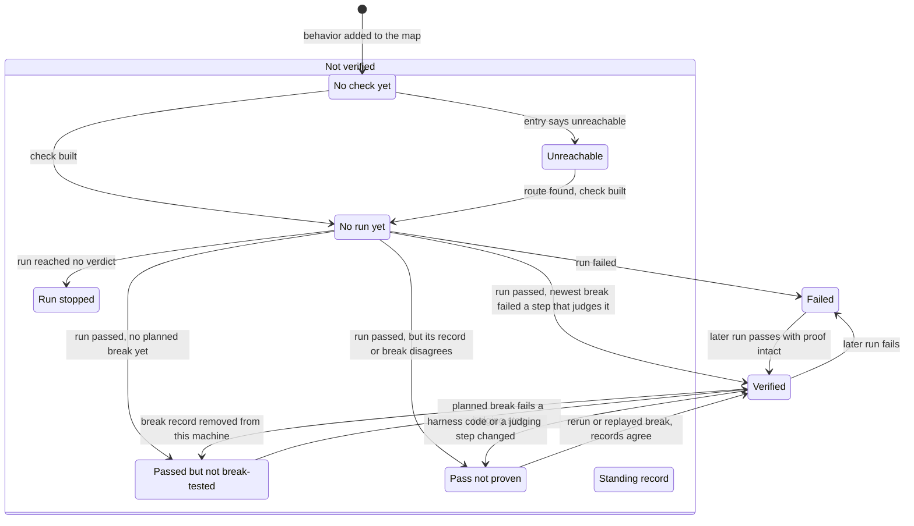
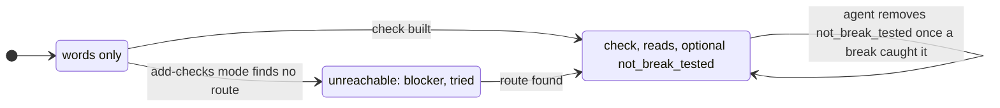
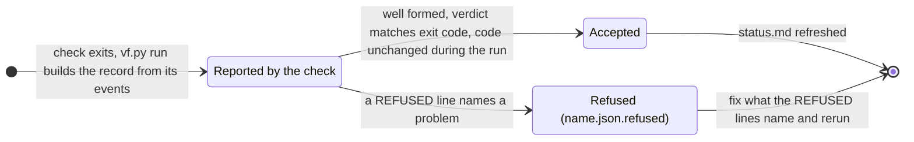
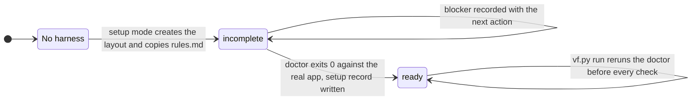

# State transitions

Where a harness, a behavior's entry (the part of its feature file that says how it is proven), a run record, and a behavior's result can be, and what moves each one. The words match `rules.md` and the output of `vf.py status`.

## A behavior's result

`vf.py status` computes one line per behavior from its entry, the accepted evidence, and any Not verified records. `vf.py validate` rejects any Verified line that `status` wouldn't write now, so one written by hand doesn't survive.

**Standing record** has no arrows because it can come from anywhere: `vf.py not-verified` puts any behavior with a check into it, whatever its result was, because `status` looks at those records before it looks at the runs. A later accepted run lifts it (with `--until-break`, a later planned break too), and the result is whatever that run earns. Every "run" above means an accepted run of a check covering the behavior.

What does **not** move a result:

- A refused run. `vf.py run` renames it `<name>.json.refused` and nothing can cite it.
- A planned-break run. It proves the check and never counts as a run of the code under test.
- A hand edit to `status.md`. `vf.py run`, `vf.py status`, and `vf.py not-verified` all rewrite it.

## A behavior's entry

Each behavior is one entry under `behaviors` in its feature file. The entry decides whether a pass can ever become Verified. Whether the check was break-tested lives in the evidence, not the entry.

The agent writes every form. Nothing in the entry says Break-tested: `vf.py status` computes that from the evidence and nothing else may claim it.

## A run record

Every check runs through `vf.py run`, which decides whether the record counts.

Before any of this, `vf.py run` runs the doctor and stops with exit code 2 when the app isn't ready, so no record is written at all.

## A harness's setup

The `setup` block of `harness.json` carries the status and the record setup resumes from. `vf.py validate` exits 2 while the status is `incomplete`, with the resume action, and nothing may drive the app until it's `ready`.

Ready means setup was once proven, not that the app is up now. Nothing moves a harness back to `incomplete`. A `rules.md` that no longer matches the hash in `framework.sha256` makes `vf.py validate` exit 1 before it checks anything else, and `vf.py sync` refuses to overwrite an edited framework copy or downgrade the rules.
